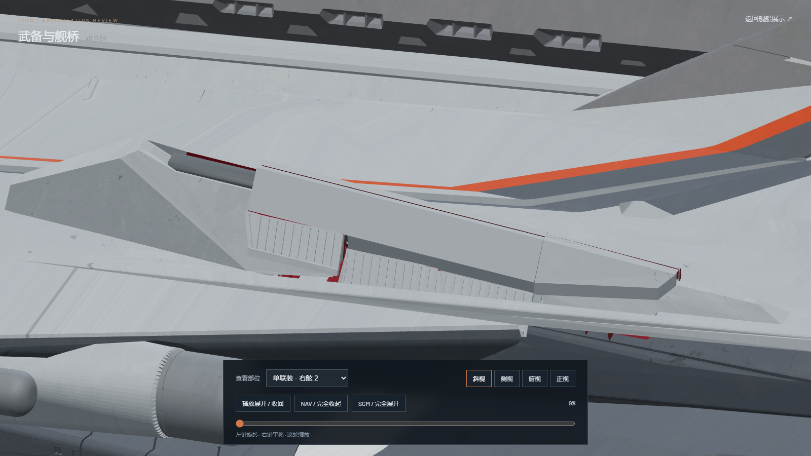
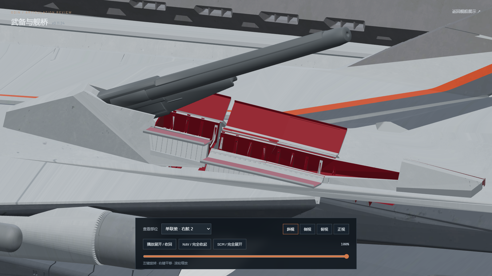
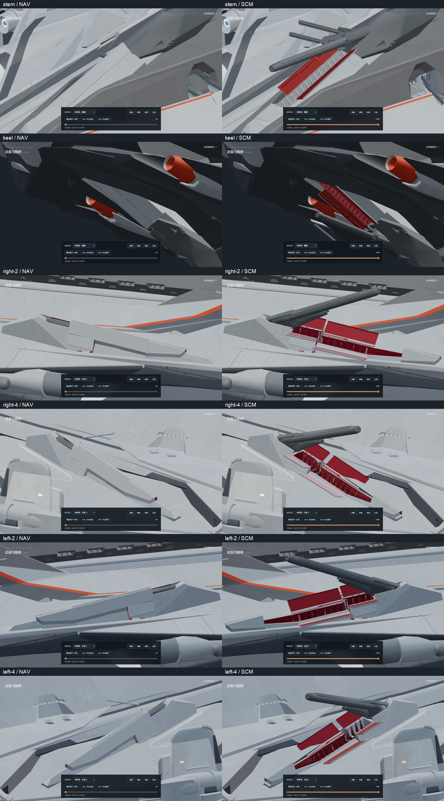
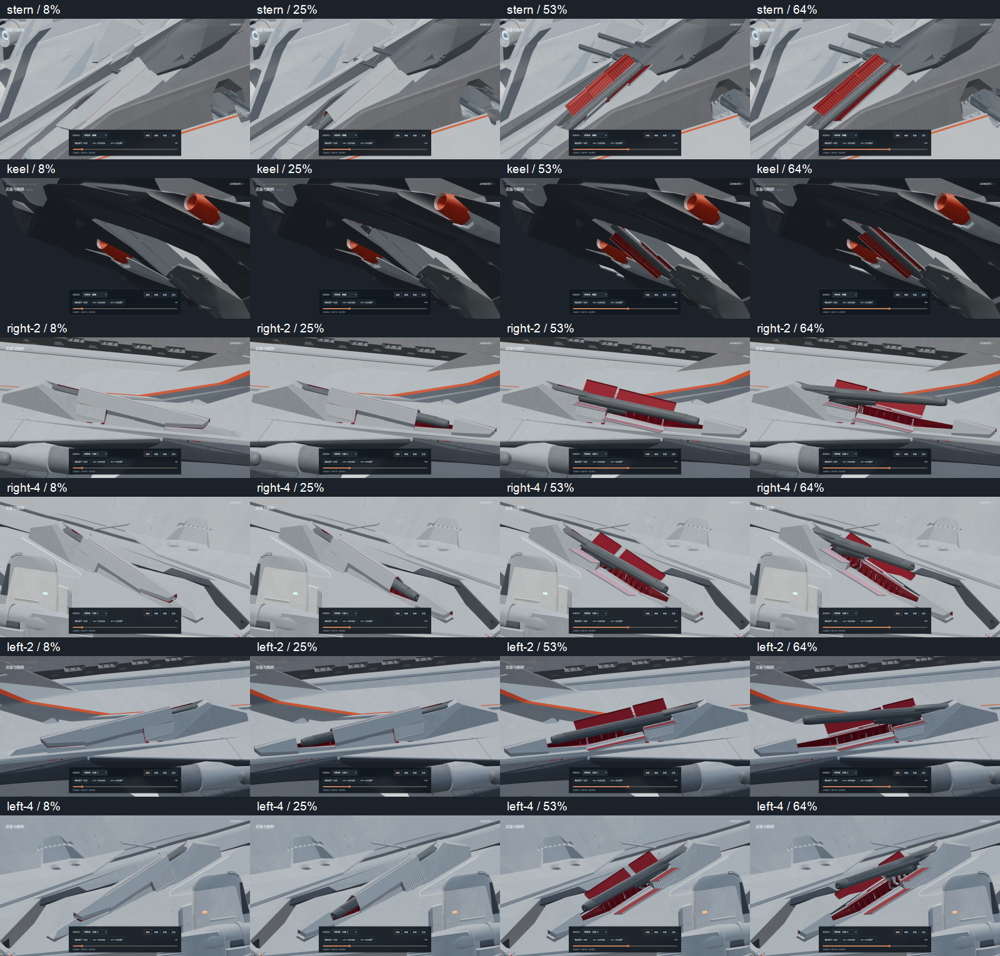
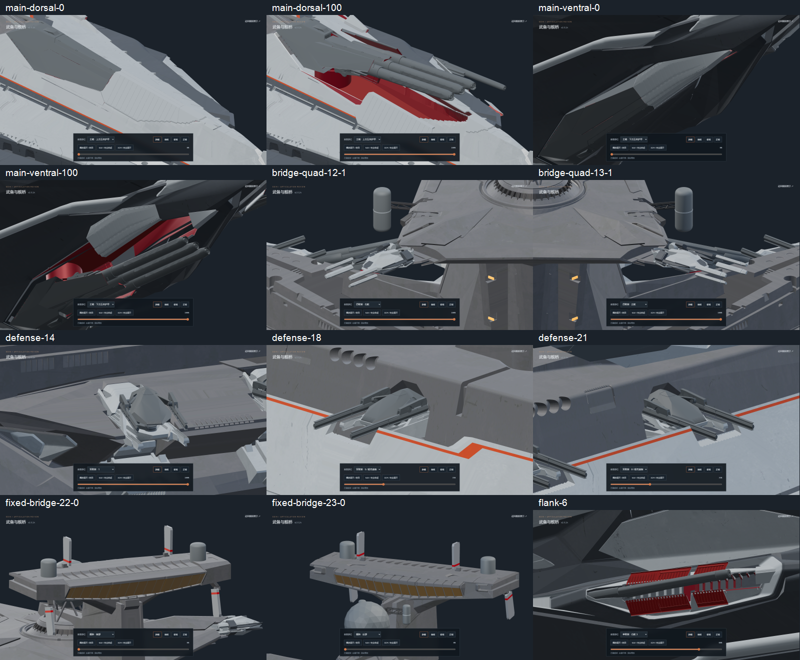

# v0.11.24-rc.1 — restore side singles 2 and 4 before rebuilding their armor

The previous side 2/4 covers included fixed grate supports and left missing
trough faces, triangular holes and long openings below the closed armor.
Their sliding nose shells were also re-profiled, and their barrels used
handmade stow offsets. This revision restores the original fixed structures
first, then fits the missing armor around the original barrel motion.

The source inventory restores 7,200 missing fixed faces and verifies all
29,790 original fixed faces in the four affected regions. Original troughs,
vented walls, raised rear banks, triangular braces and transverse bearings
remain fixed. No fixed source face is assigned to an armor joint. The four
old substitute slot-lip meshes are removed. Outside these regions, 482
existing mesh/material hashes and 155 other joint matrices are unchanged.

Each mount uses six missing exterior covers derived from the accepted
side-1 armor assets. Constant-gauge skins and lower sealing skirts meet the
unchanged source walls. Their inward skins and reinforcement are red, their
exteriors gray, and their contact-edge hinges stop at 95 degrees. The original
double nose shell retains its shape and UVs; it receives a rigid outward
clearance offset and new lower sealing returns rather than stretching its
source vertices. It lifts during 0–8%, advances during 10–23%, and settles
by 26%. The six leaves clear by 41.4%.

The barrels use the exact source geometry, stationary origins and all three
original Euler channels. Original keyframe timing is retained: side 2 starts
at frame 48, side 4 at frame 43, and both end at frame 90 on the 100-frame
review timeline. Port motion reflects the original starboard source. There
is no added barrel sink, pitch offset or translation.

Editable geometry: [odin_articulated_v0.11.24.blend](../../../assets/blender/odin_articulated_v0.11.24.blend).
The read-only original `odin.blend` remains unchanged (SHA-256
`9ec8b6ee36e6315c7c0cae8576472879518cc5bf48b79382c2affbcbd71af15e`).
Both GLBs contain static geometry, materials and joints, with **zero animation
clips**. Every motion runs in Nuxt/Three.js.

Validation:

- `npm test`: 48 passing, including independently sampled source barrel
  positions, original timing, stationary origins and reversible rigid armor.
- `npm run verify:asset`: both high and lite models pass.
- `npm run generate`: static preview generation passes.
- [Source restoration audit](source-restoration.json): fixed source topology
  is complete; original nose coordinates differ only by a rigid displacement.
- [Mesh clearance audit](mesh-clearance.json): actual triangle intersection
  checks at 101 positions per mount, 404 total, detect no barrel/armor
  intersections. Minimum closed-roof vertical clearance is 0.897 model units.
- [Browser checks](browser-check.json): 24 endpoint views, 60 forward/reverse
  motion poses, 33 other armament poses and two axial crown details at
  1600×900. Main batteries, secondary batteries, defense/PDC mounts, bridge
  quad arms and fixed bridge armor were checked. No console errors.
- Paused review rendering remains at 99 frames over the idle interval.
  Playback resumes rendering; explicit pause survives view changes. The
  automated checking browser is closed after review. One static preview
  server remains available; no additional in-app tabs were opened.

