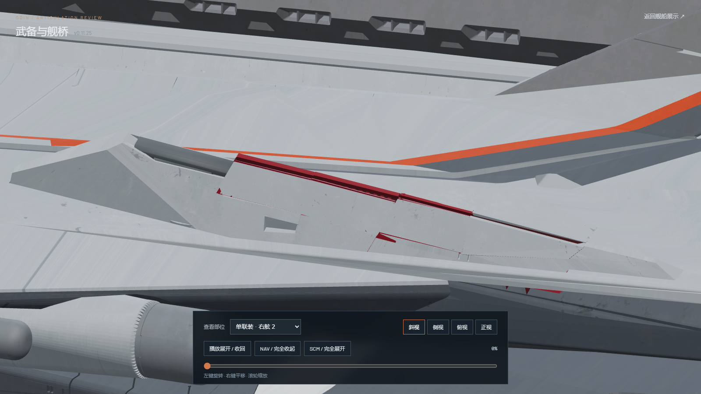
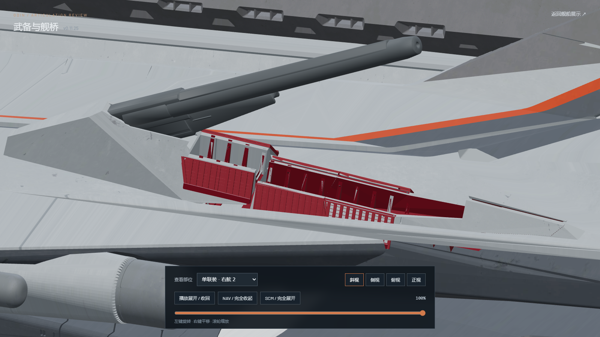
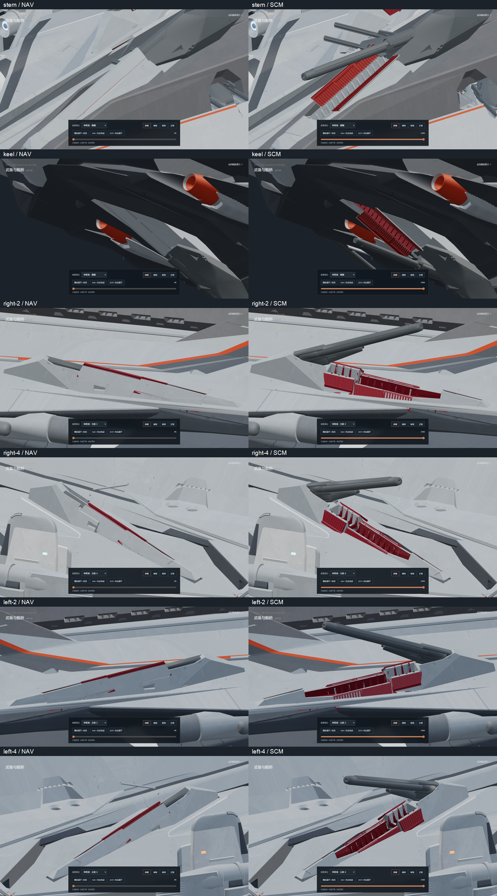
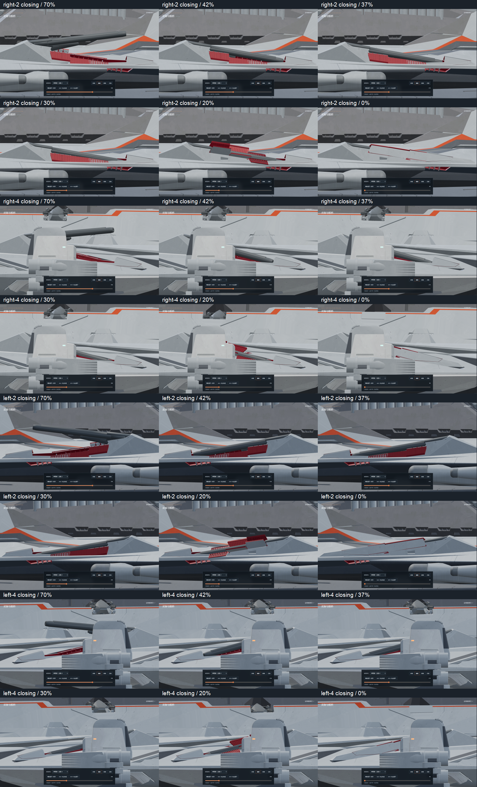
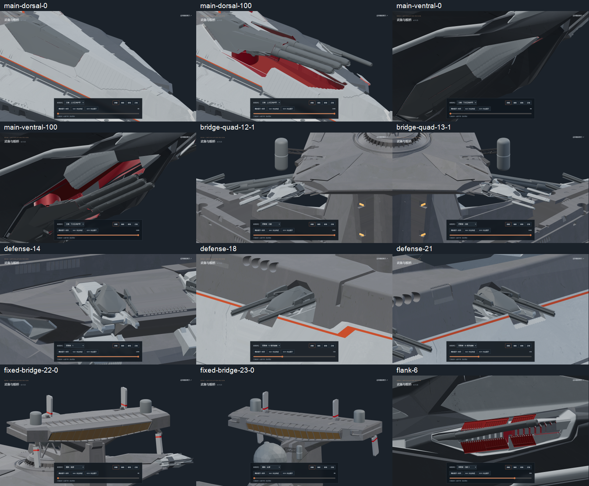

# v0.11.25-rc.1 — original side 2/4 armor and moving turret shells

Side singles 2 and 4 previously used copied side-1 covers, while the six
original vented leaves stayed fixed. Their rear turret shells also stayed
fixed, leaving the closed roof at the wrong height. This revision uses the
actual six original armor assemblies and original double nose shell on each
mount. It removes the substitute skins, reinforcement and sealing returns.

All 12,294 moving source polygons retain their original corner positions and
UVs in the authored open pose. The original stationary troughs, cheek braces
and forward transverse supports stay on the hull. A separate left-4 source
object contained the turret housing and two lower bearings; its old bevelled
fixed housing duplicate is removed, and all 1,590 original bearing faces are
restored and remain fixed. Original inward armor details and channel surfaces
are red; outward armor remains gray.

The original rear turret shell, its channel supports, barrel and rearmost
pair of armor leaves share one carriage. The four forward leaves stay on the
hull. The closed carriage moves 0.4 model units forward and 1.6 down, with its
raise phase at 32–42%. Each original leaf uses a rigid hinge; the closed inner
roof planes match across the three banks. There is no scaling or reshaping
of these source leaves. The nose lifts by 3%, advances during 4–10%, and
returns to its exact source open position by 11%. Leaves open during 12–28%.

As requested, barrel roots and their physical pivots move together 1.6 units
aft and 0.6 up in the deployed turret frame. A two-degree rigid rest correction
lowers the muzzle. The original three-channel Euler curves and timing remain
intact: side 2 uses frames 48–90 and side 4 uses 43–90. The port motions mirror
the source starboard actions. Reversing the timeline stows the barrel first,
then seats the turret forward/down, then closes the armor.

The accepted bow, stern, keel, side 1/3, main, defense/PDC and bridge mechanisms
retain their geometry and motions. The builder verifies 481 other mesh/material
hashes and 155 other joint matrices against v0.11.24.

Editable model: [odin_articulated_v0.11.25.blend](../../../assets/blender/odin_articulated_v0.11.25.blend).
The original `odin.blend` remains unchanged: SHA-256
`9ec8b6ee36e6315c7c0cae8576472879518cc5bf48b79382c2affbcbd71af15e`.
High and lite GLBs contain geometry, materials and static joints, with zero
animation clips. All animation is authored in Nuxt/Three.js.

Validation:

- `npm test`: 49 passing, including independently sampled original barrel
  positions, moved pivots, reversible source covers and the required closing
  order with the final pair following its turret.
- `npm run verify:asset`: both models pass, including red inward faces,
  original leaf ownership and absence of the previous substitute covers.
- `npm run generate`: the static preview build passes.
- [Source geometry audit](source-geometry.json): 36 moving source meshes,
  12,294 original polygons and unchanged UVs; 17,686 fixed source polygons
  in the four mount regions are present, plus the left-4 bearing pair. No
  moving source polygon remains duplicated in the three fixed hull meshes.
- [Triangle clearance audit](mesh-clearance.json): 101 positions per mount,
  404 total, detect zero barrel intersections with the seven moving covers.
  Breech/socket housing contacts and armor/frame surface contacts (including
  touching hinge and seated edges) are recorded separately, along with their
  original-model baselines.
- [Browser review](browser-check.json): desktop views cover the four revised
  mounts, their opening/closing sequence, accepted stern/keel armor, main and
  secondary batteries, defense/PDC mounts, bridge quad arms and fixed bridge
  armor. Paused review rendering stops, and explicit pause survives view changes.
  The checking browser is closed after review; one static preview server remains.

