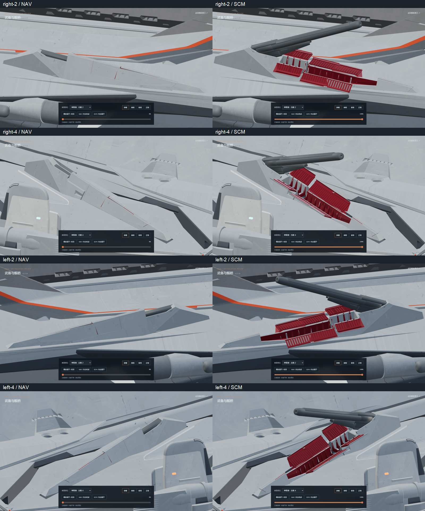
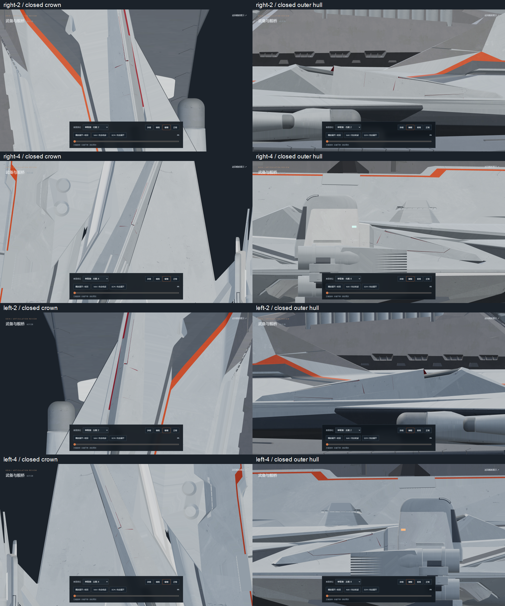
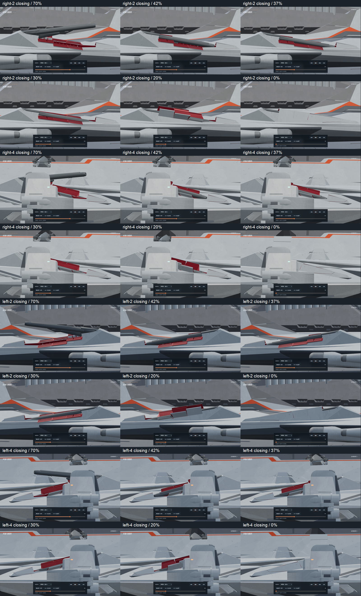
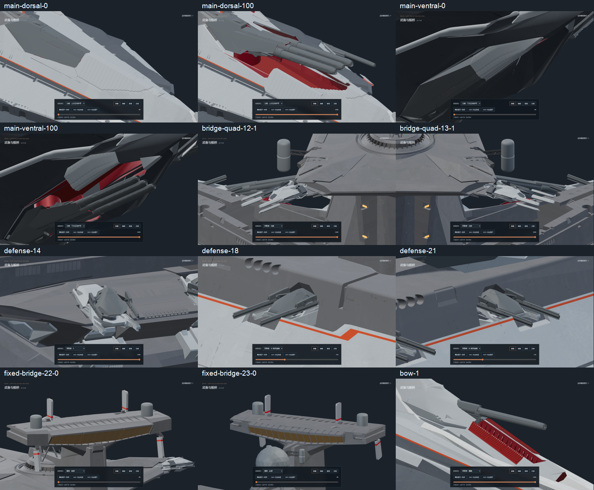

# v0.11.26-rc.1 — fitted source flank armor and restored outer hull

The side-2 and side-4 source covers had uneven closed edges, an open center
ridge and exposed recesses below the leaves. The original outer belt below
both side rails was also missing. This revision extends the existing source
armor in-place: its exterior ends and lower edges align, and its upper edge
continues into a finite-width flat crown with a narrow center seam. It retains
the six source grate assemblies and original double nose shell per mount;
new inward returns use deep red and exterior surfaces remain gray.

Eight original outer-belt polygons are recovered from `odin.blend/holo.001`
at their exact source coordinates and UVs. They stay on the fixed hull. The
short original cheek walls gain local exterior contour extensions below the
covers; their upper edges leave clearance for the hinge sweep. No bearing,
inner trough or transverse support is removed to make a rotating cover.

The six leaves of each side-2 mount stop at the previous front-leaf orientation
at 20% deployment. Side-4 uses the corresponding 18% orientation. These are
maximum leaf sweeps; the cap release, carriage lift and original three-channel
barrel timing keep their existing phases. Closing still stows the barrel,
seats the turret and rear armor pair, then closes the covers.

The two original side-4 elevation linkages had remained fixed in their source
deployed position, leaving floating rails above the stowed bay. Each complete
36-vertex, 24-polygon source assembly now follows its barrel. Its geometry is
rigidly calibrated from the source deployed endpoint; the existing barrel
root, pivot, rest correction and Euler curves remain unchanged.

Editable model: [odin_articulated_v0.11.26.blend](../../../assets/blender/odin_articulated_v0.11.26.blend).
The original `odin.blend` is unchanged: SHA-256
`9ec8b6ee36e6315c7c0cae8576472879518cc5bf48b79382c2affbcbd71af15e`.
Both GLBs contain static geometry, materials and joints, with zero animation
clips. Animation remains authored in Nuxt/Three.js.

Validation:

- `npm test`: 50 passing. Coverage includes source barrel samples on both
  mirrored sides, required closing order, exact reference opening limits,
  measured closed exterior planes and lower edges, source details and UVs,
  and reversible articulation.
- `npm run verify:asset`: high and lite assets pass, including source cover
  ownership, gray exteriors, red interiors and the moving side-4 linkages.
- `npm run generate`: static preview build passes.
- [Source and geometry proof](source-geometry.json): all original polygons
  and UVs of the 28 fitted source covers remain; the restored belt and both
  elevation linkages match the original source. Twelve barrel, housing and
  rear-support meshes are unchanged. Across the asset, 498 other mesh/material/
  UV hashes and all 191 joint rest transforms match v0.11.25.
- [Triangle clearance audit](mesh-clearance.json): 101 poses per mount, 404
  total, detect zero barrel/linkage intersections with the seven moving
  covers. Housing/socket contacts and fixed receiver/hinge surface contacts
  are recorded separately; this is not a zero-contact claim for mechanical
  interfaces.
- [Browser review](browser-check.json): all four revised mounts are checked
  in both directions and multiple views. Regression coverage includes bow,
  stern, keel, other secondary batteries, both main batteries, defense/PDC,
  bridge quad arms and fixed bridge armor. Explicit pause survives view
  changes, and the paused review stops rendering. One checking browser is
  closed after review; one static preview server remains.

