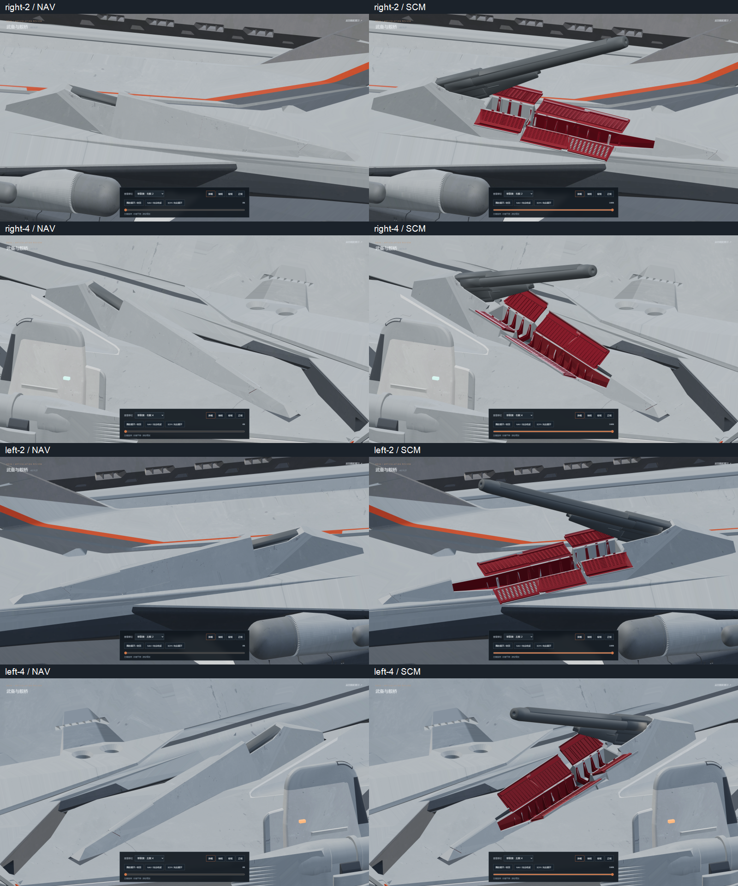
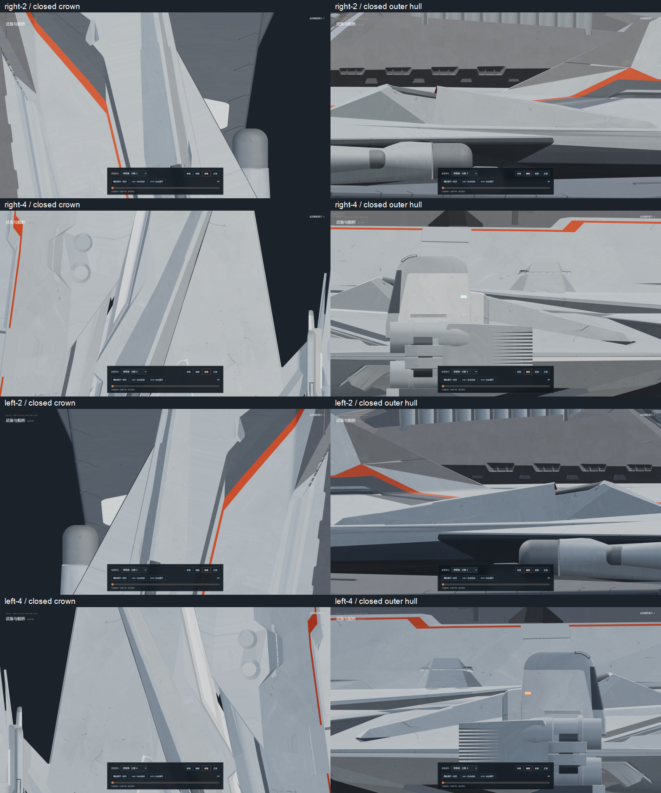
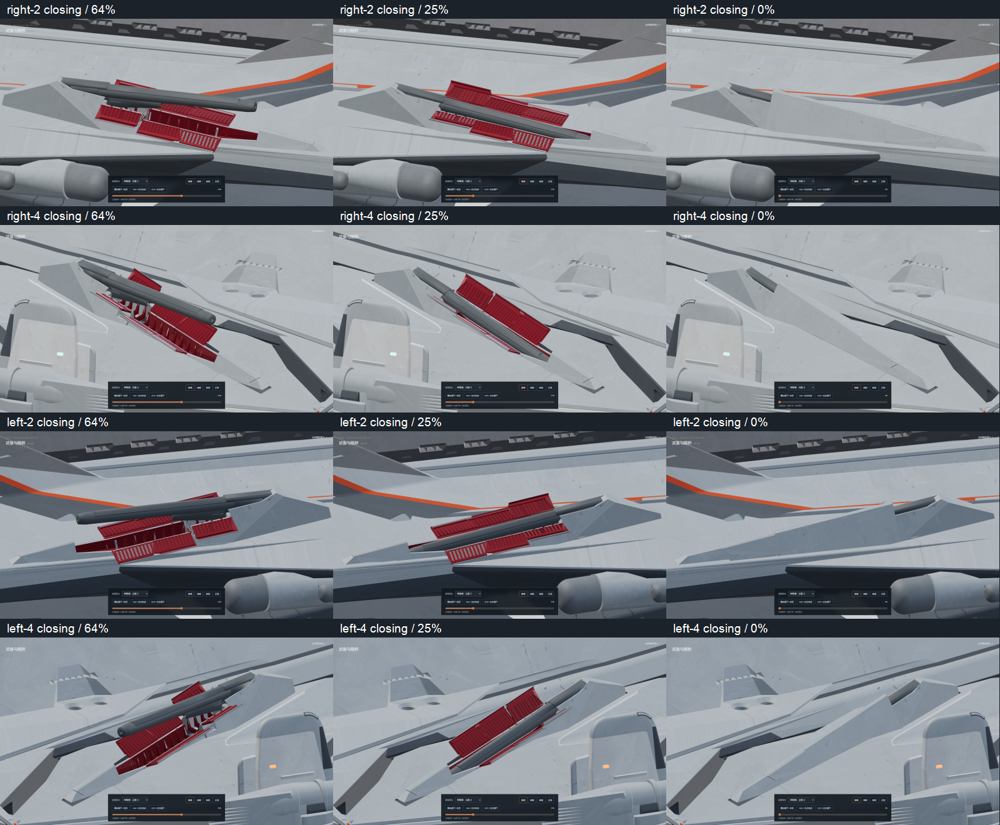
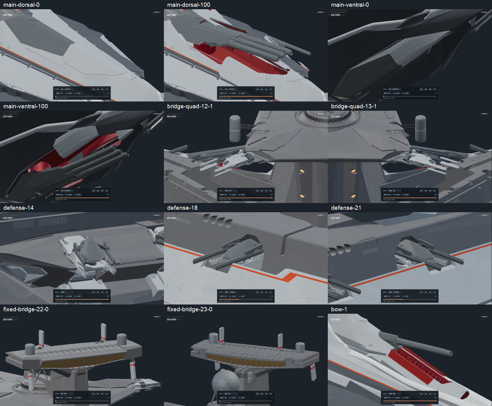

# v0.11.27-rc.1 — sealed source flank armor and removed fixed housing duplicate

The middle and forward original armor leaves on both side-2 and side-4
mounts left small see-through end seams. Their original small exterior
triangles and rolled edges now match the closed bank profiles, including
the complete lower edge. The original nose shell's rear contour matches
its neighboring leaf; the leading receiver edge remains unchanged.
Thin gray inner returns hide the bank, nose and center-roof seams, with
red undersides. The roof retains its finite-width flat crown.

The old `Odin_Restored_Starboard_Housing` contained a stationary duplicate
of the side-4 housing as well as two legitimate fixed bearing islands.
Only its 359 housing polygons are removed. Its 1,590 bearing polygons,
coordinates, materials and UVs are retained in
`Flank_4_Starboard_FixedBearingPair`. Two previously miscolored hull
receiver end faces below the side-2 front lips regain their gray exterior
material without changes to the fixed hull geometry or UVs.
The two original side-2 floor quads extend beyond the inner channel. Their
outer lip bands regain gray paint through thin clipped finish faces; the
complete original floor polygons and UVs stay intact and their channel
interiors stay red.

All 191 joint rest transforms and motion properties match v0.11.26.
This includes the original three-channel barrel action, corrected pivots,
the turret and rear-pair carriage, nose stroke and the 20%/18% reference
opening stops. Closing still stows the barrel, seats the turret and rear
pair, then closes the armor. The source grates remain intact and inward
surfaces remain red.

Editable model: [odin_articulated_v0.11.27.blend](../../../assets/blender/odin_articulated_v0.11.27.blend).
The original `odin.blend` is unchanged. Both GLBs contain static geometry,
materials and joints, with zero animation clips. Animation remains in
Nuxt/Three.js.

Validation:

- `npm test`: 51 passing, including source barrel samples on both mirrored
  sides, exact motion order and opening stops, reversible articulation,
  and the seam/duplicate regression tied to the editable model hash.
- `npm run verify:asset`: high and lite assets pass.
- `npm run generate`: static preview build passes.
- [Source and geometry proof](source-geometry.json): all polygons and UVs
  of the 28 original fitted covers are retained. Every original vertex
  not connected to a fitted exterior skin stays unchanged. The two fixed
  bearings and 502 unrelated meshes match the previous model. The fixed
  hull's original polygons, coordinates and UVs are unchanged. Two exterior
  end-face materials change and four gray outer-lip finish faces are added.
- 6,480 actual mesh rays across all four closed mounts find zero open
  seams or red interior first hits at the bank, nose and flat center roof.
- [Clearance audit](mesh-clearance.json): 101 poses per mount, 404 total,
  detect zero barrel/linkage intersections with the seven moving covers.
  Housing/socket and fixed receiver/hinge contacts are recorded separately;
  this is not a zero-contact claim for mechanical interfaces.
- [Browser review](browser-check.json): 123 rendered views cover the four
  revised mounts, forward/reverse motion, bow/stern/keel, main batteries,
  other secondary batteries, defense/PDC, bridge quad arms and fixed bridge
  armor. Explicit pause survives view changes and paused rendering stops.
  The checking browser is closed after review; one static preview server
  remains.

