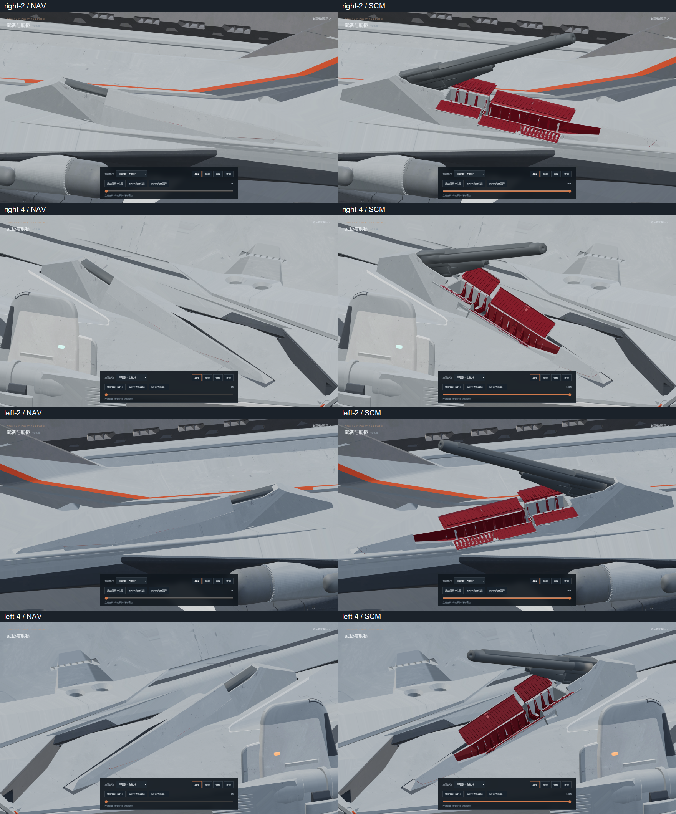
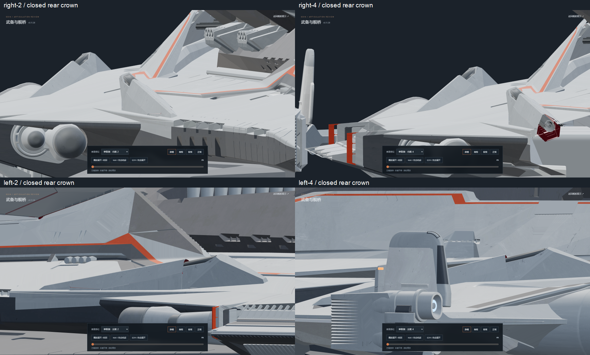
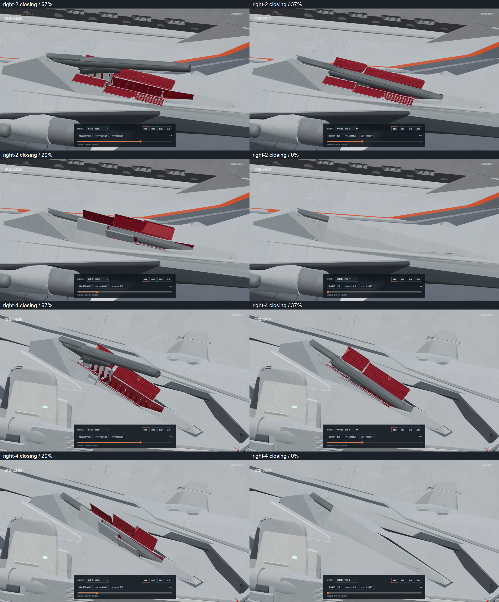
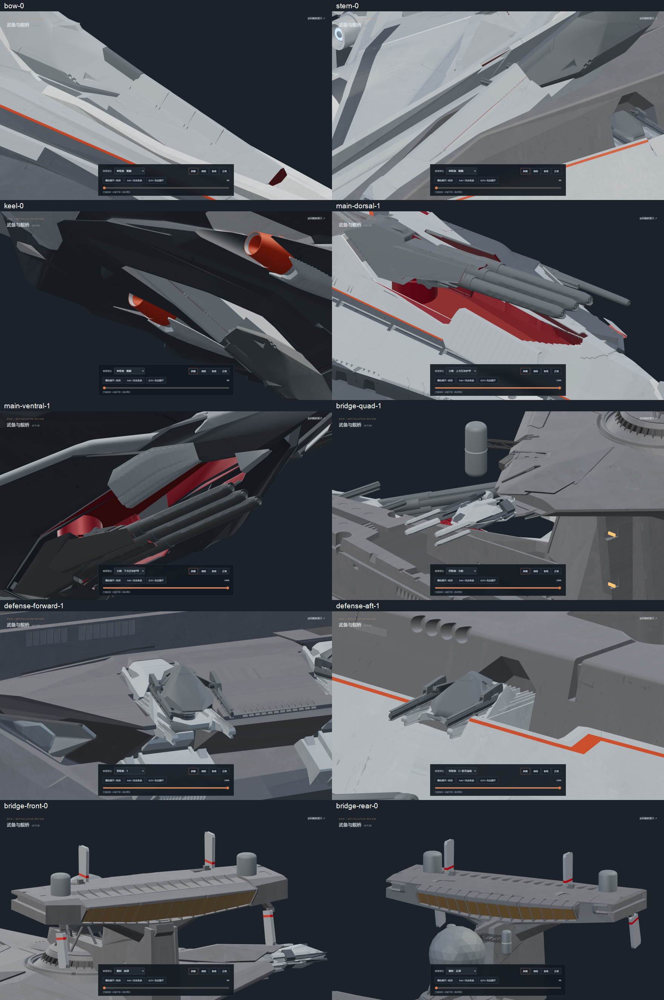

# v0.11.28-rc.1 — lower, aligned original flank armor crowns

Closed side-2 and side-4 covers had a stepped top line when viewed from
behind: the original rolled edges, crown extensions and front cap did
not share one profile. All six original hinged covers and the original
front cap on each of the four mounts now follow one straight, lower
roof line. The flat crown narrows from 0.90 to 0.60 source units.
Side-2 crown height reduces by 0.965 source units; side-4 reduces by
0.745. Their original armored barrels set the required inward clearance.

The local fixed front receiver and nose fairing continue the same roof
line. A small upper turret cheek is fitted beneath it. Side-2 rear diagonal
rib feet move outward by up to 0.23 units within the original hinge edge;
this clears the breech without raising the complete roof. Original source
armor polygons, vent detail and UVs are retained. Only inward rib tips
above the new skin are shortened; the complete grates are not compressed
into the bore channel. Gray narrow overlaps cover bank seams and all inward
surfaces retain their red finish.

Two floating triangles beside the side-4 mounts were disconnected one-face
islands. Those two faces are removed; no fixed bearing or hull assembly is
removed with them.

All 191 joint rest transforms and mechanical motion properties match
v0.11.27. Only cover geometry properties describing the narrower crown
and new side plane change. Original barrel geometry, corrected pivots,
three-channel Euler action, turret carriage stroke, cap stroke, closing
order and the previous 20%/18% reference opening stops remain unchanged.

Editable model: [odin_articulated_v0.11.28.blend](../../../assets/blender/odin_articulated_v0.11.28.blend).
The original `odin.blend` remains unchanged. Both GLBs export static
geometry, materials and joints with zero animation clips. Animation
continues to run in Nuxt/Three.js.

Validation:

- `npm test`: 52 passing, including the native-model hash, actual roof
  and seam probes, preserved original motion and reversible articulation.
- `npm run verify:asset`: high and lite assets pass, with zero clips.
- `npm run generate`: static preview build passes.
- [Source geometry proof](source-geometry.json): all original polygons and
  UVs of the 28 covers remain; 499 unrelated meshes are unchanged.
- 9,548 actual mesh rays sample the four full roof lines, bank/cap seams
  and fixed front receivers. There are no misses or red interior first
  hits. Maximum crown error is 0.0061 units at the thin gray seam overlap;
  fixed receiver crown error is under 0.000003 units.
- [Clearance audit](mesh-clearance.json): 404 poses produce zero
  barrel/linkage contacts with the seven moving covers. Source housing,
  socket, hinge and fixed-hull interface contacts are recorded separately;
  this is not a zero-contact claim for those mechanical interfaces.
- [Browser review](browser-check.json): 102 rendered views check both
  sides, rear/upper-rear views, forward/reverse motion, main batteries,
  other secondary batteries, defense, quad/PDC mounts and bridge armor.
  Explicit pause survives view changes and paused rendering stops.
  The checking browser is closed after review; one static preview remains.

