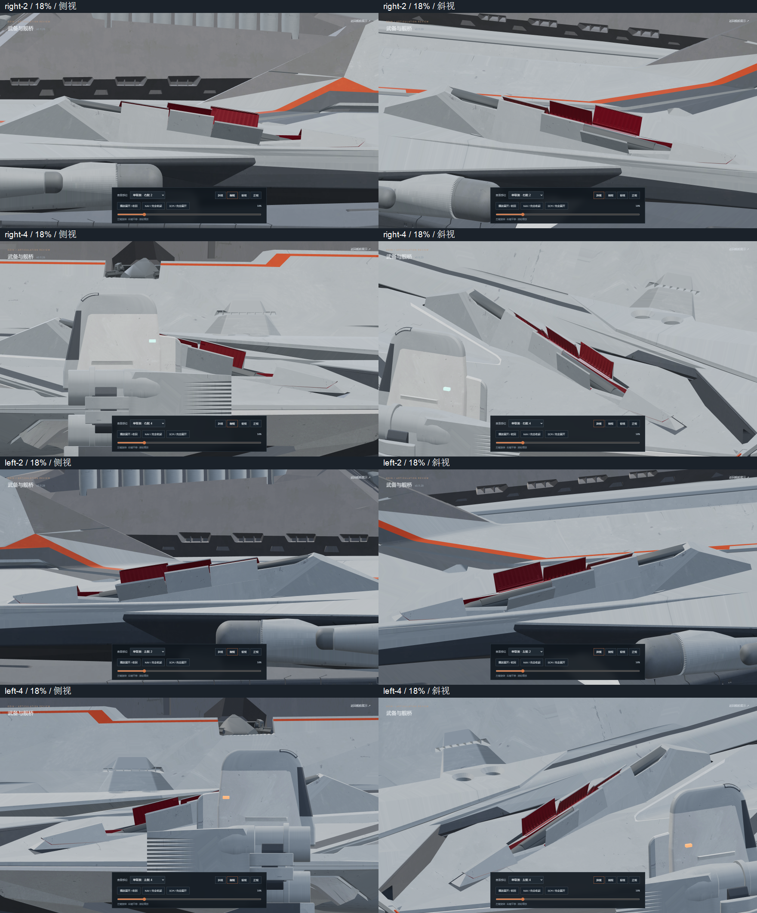
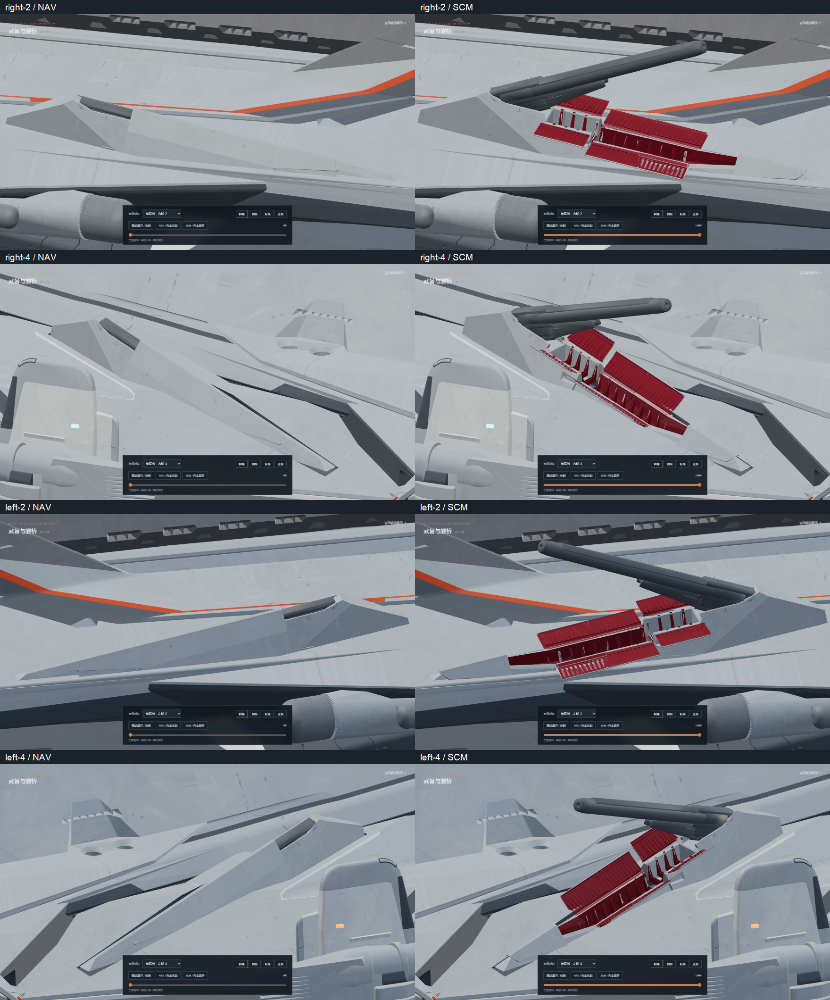
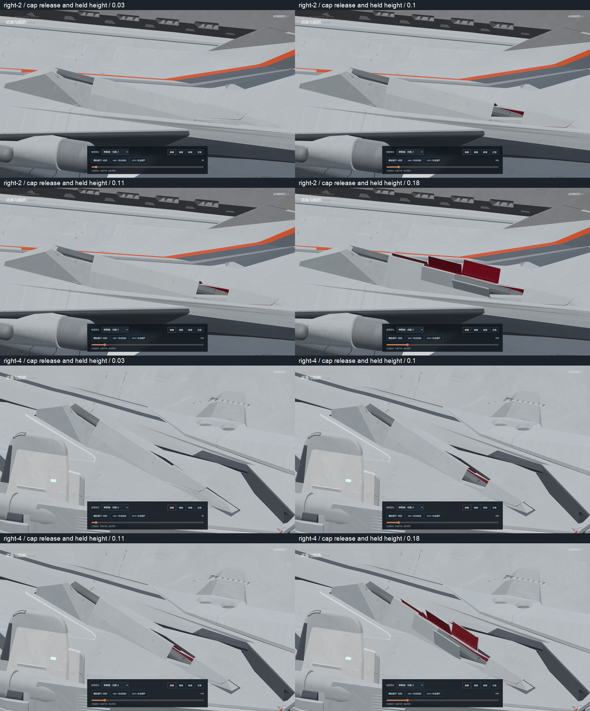
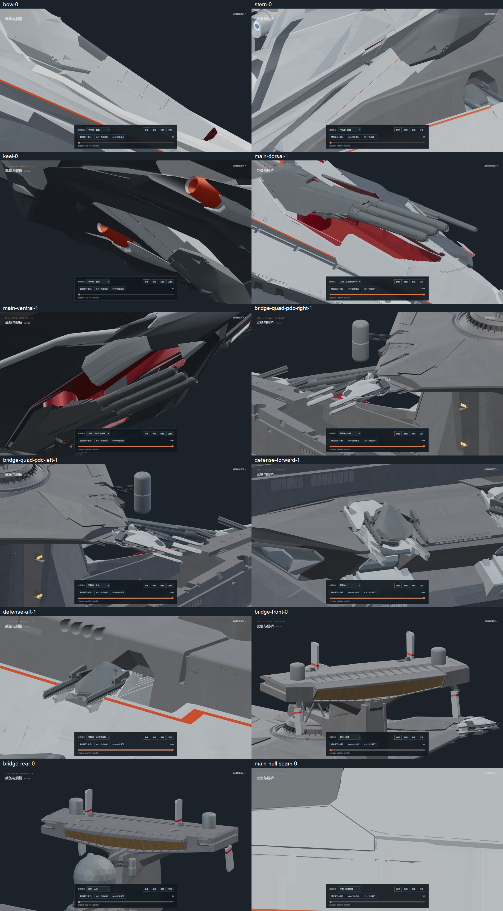

# v0.11.29-rc.1 — flank armor seam hinges and lining ownership

The side 2/4 armor now rotates about the actual lower cover-to-hull seam.
Both sides use a continuous rail in the closed bay frame: cross coordinate
±2.88, normal height `1.7756 − 0.007 × longitudinal coordinate`.
The fixed outer cheek lips and their inward returns follow this same rail.
The rear pair retains its original moving-turret parent.

The original inward lining is divided at the matching cover-bank boundaries,
−8.195 and 0.325. Parts extending into a neighboring bank move with that bank.
Source render triangles are retained or split with interpolated UVs. The
accepted exterior contour, narrow flat crown, original ribs, barrels, bore
pivots, source Euler action, turret stroke and limited opening travel remain.
The front cap lifts and advances, then holds its height; the former final
downward settling phase is omitted on these four mounts.

Validation:

- `npm test`: 53 passing tests, including source barrel action, closing order,
  common hinge rails, lining boundaries, reversible scrubbing and cap height.
- `npm run verify:asset`: both GLBs pass; zero animation clips.
- `npm run generate`: successful static build.
- [Source geometry proof](source-geometry.json): all 6,432 noncollapsed source
  surfaces retained across the 24 leaves. The 448 already collapsed source
  faces have no rendered area. Maximum per-face surface-area difference is
  0.000099 source units²; maximum UV error is 0.000000059.
- [Closed roof and fixed lip proof](roof-geometry.json): 9,548 crown, bank-seam
  and receiver rays plus 1,928 local cheek-lip rays. No missing surfaces or
  red inward surfaces exposed through these closed exterior seams.
- [Clearance audit](mesh-clearance.json): 101 poses per mount, 404 total; no
  barrel or elevation-linkage contacts with moving covers. Source socket and
  fixed-hull mating contacts are recorded separately.
- [Browser checks](browser-check.json): all four repaired mounts at 18%,
  both endpoints and a complete forward/reverse sequence. Main batteries,
  remaining singles, twin defense mounts, bridge quad arms, PDC petals and
  fixed bridge are also inspected. Explicit pause remains active and the
  idle preview stops rendering. The temporary checking browser is closed.

The original `odin.blend` SHA-256 remains
`9ec8b6ee36e6315c7c0cae8576472879518cc5bf48b79382c2affbcbd71af15e`.
Editable geometry is committed as
`assets/blender/odin_articulated_v0.11.29.blend`; final export hashes are in
[asset-hashes.json](asset-hashes.json).

