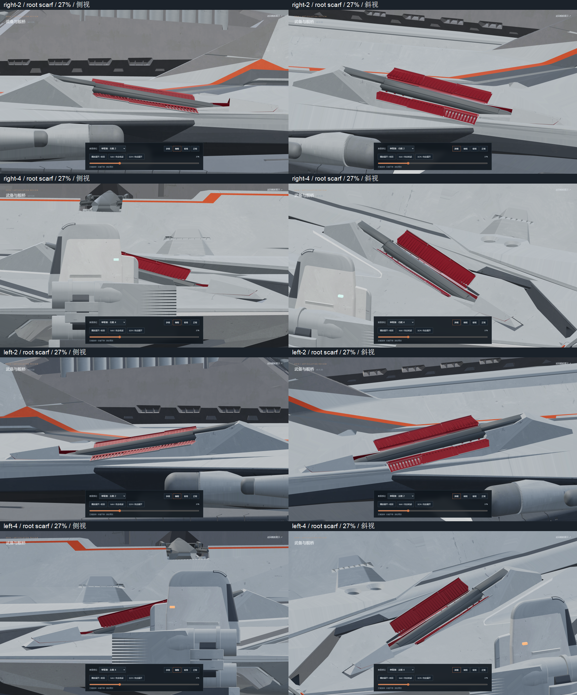
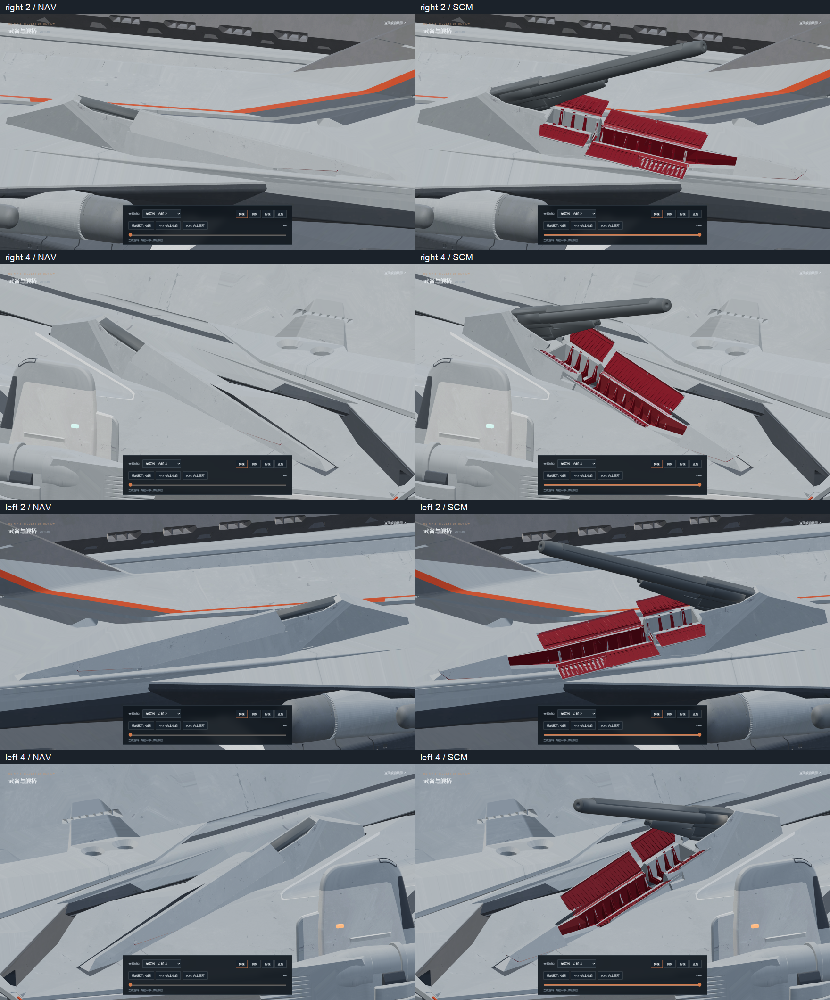
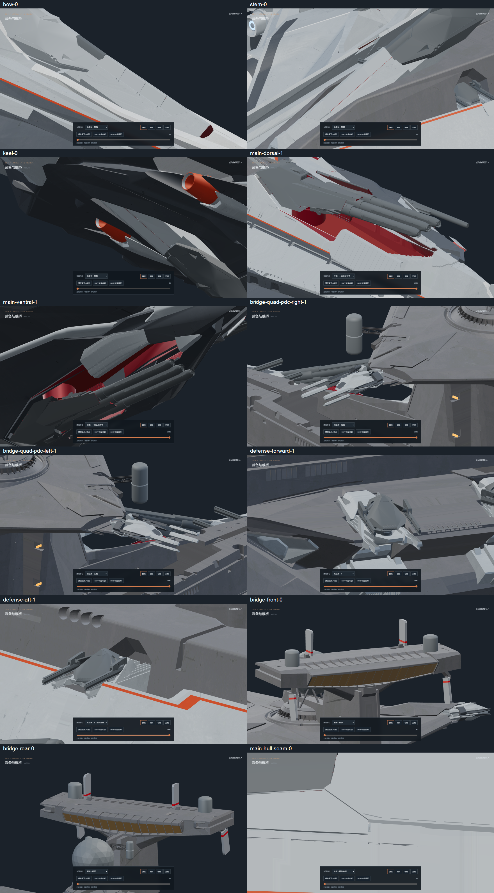

# v0.11.30-rc.1 — original flank rear armor root bevels

The aftmost folding armor previously had a straight rear end beside the
inclined turret-root housing. Both rear leaves on each port/starboard side
2/4 mount now follow the two original housing bevels. The source faces are
measured in the closed bay frame, then the original leaves are trimmed with
a 0.055 longitudinal clearance. Newly cut ends are closed; gray exterior and
deep-red inward details retain their materials.

The original root housings, common lower seam, all hinge transforms, barrel
pivots, source barrel action, carriage stroke, opening limits and raised
front-cap parking are preserved. The eight rear leaves continue to move
with their original turret carriages. No fixed housing or hull geometry is
removed for this change.

Validation:

- `npm test`: 54 passing tests, including source bore action, closing order,
  common seam hinges, original surface/UV clipping and source-root clearance.
- `npm run verify:asset`: high and lite GLBs pass; zero animation clips.
- `npm run generate`: successful static build.
- [Root fit](root-fit.json) identifies each original housing face and its
  two measured inclined planes.
- [Independent native geometry check](root-geometry.json) reloads both
  versions: 524 unrelated meshes and 191 mechanical joint transforms and
  properties remain unchanged. Retained source surfaces and interpolated
  UVs are checked against exact clipping of the previous render triangles.
  All 288 near-edge closed-roof rays hit gray exterior with no openings.
- [Clearance audit](mesh-clearance.json): 101 poses for each of four mounts,
  404 total. No rear-cover contact with the corresponding source root bevels
  and no barrel/elevation-linkage contacts with any moving cover. Full source
  socket, lining, housing and fixed-hull mating contacts are recorded
  separately; they are not claimed to be absent.
- [Browser checks](browser-check.json): all four mounts at 27%, 18%, NAV,
  SCM and a complete forward/reverse sequence. Main batteries, remaining
  singles, defense twins, bridge quad arms, PDC and bridge are also checked.
  No console errors; explicit pause persists and idle rendering stops.
  The temporary checking browser is closed and one static preview remains.

The original `odin.blend` SHA-256 remains
`9ec8b6ee36e6315c7c0cae8576472879518cc5bf48b79382c2affbcbd71af15e`.
Editable geometry is saved in
`assets/blender/odin_articulated_v0.11.30.blend`; exported asset hashes are in
[asset-hashes.json](asset-hashes.json).

