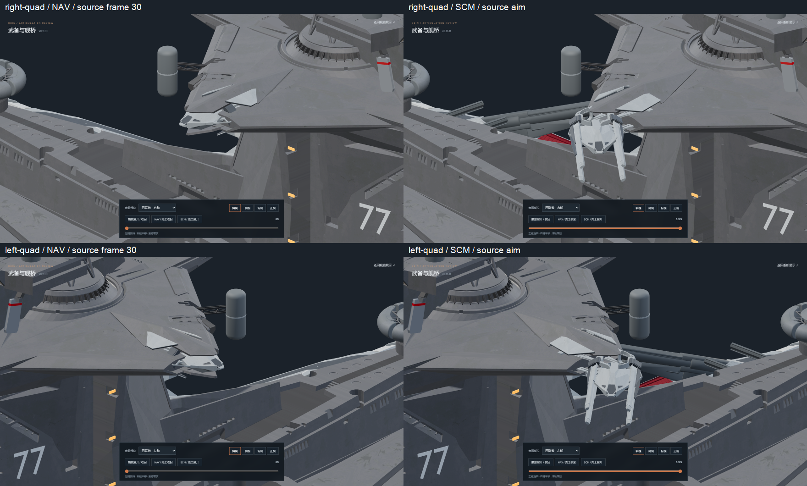
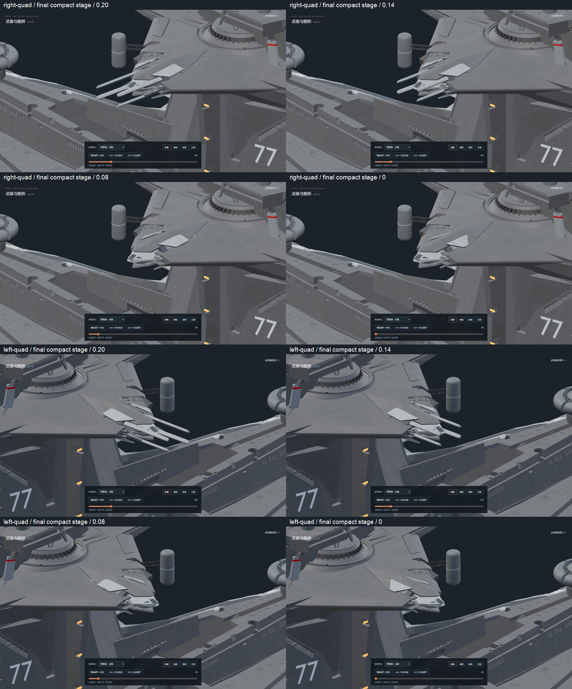
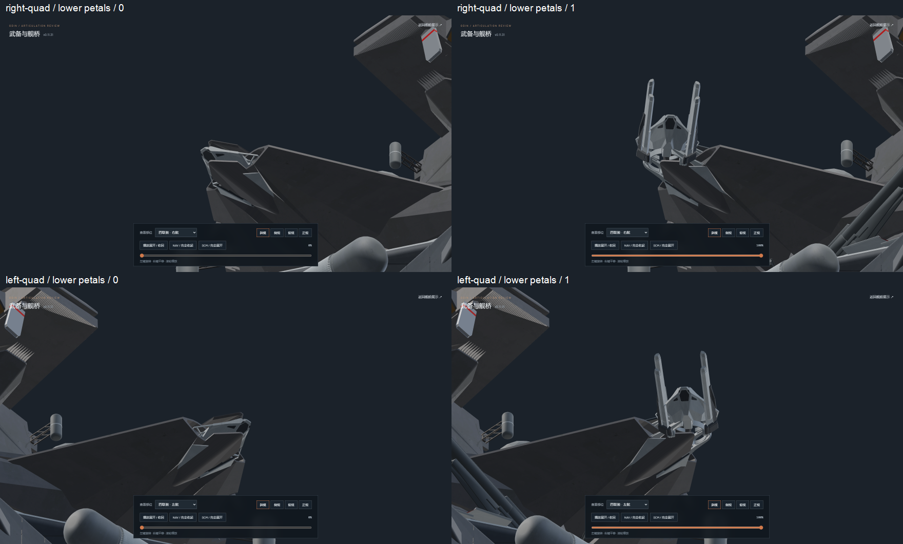
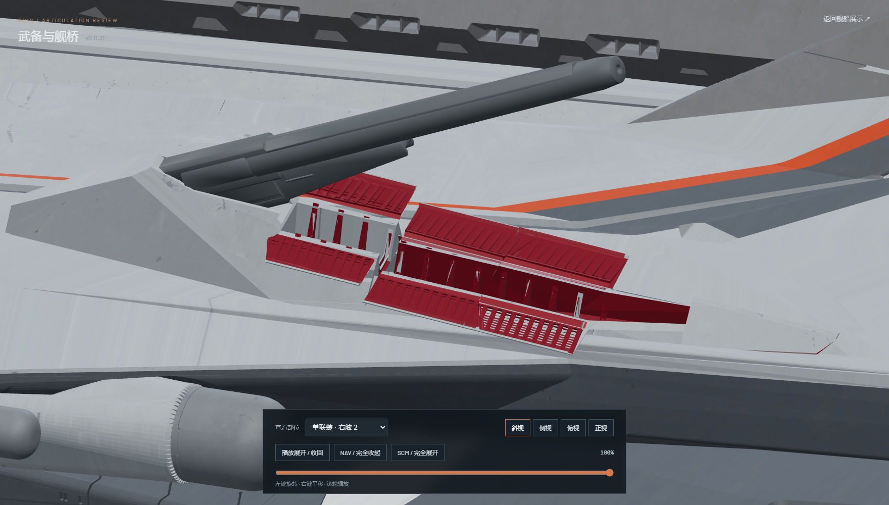
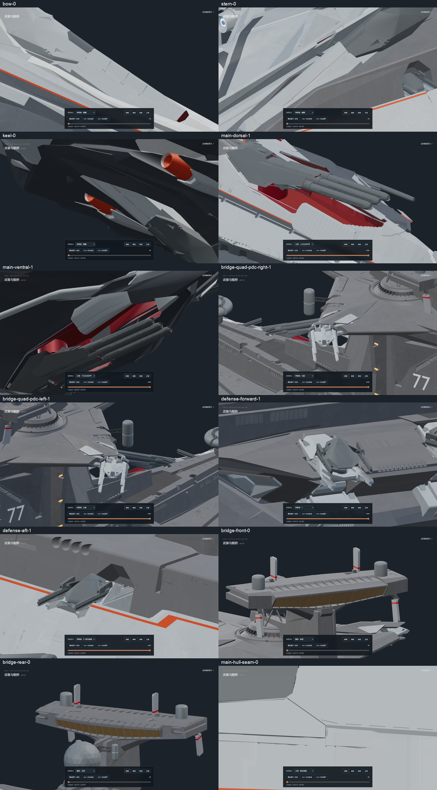

# v0.11.31-rc.1 — original bridge quads and coordinated stow

Both bridge quad turrets recover the complete original `holo.014` gun assembly
and `holo.016` support from `odin.blend`. Each mount retains all 5,001 original
gun vertices, 1,602 support vertices, every source face and its UV coordinates.
The clipped tubes, narrowed forks and substitute fixed guides are removed.
The four original hull armor petals per mount retain their geometry and
original gray materials, without red or orange paint.

The turret now retracts to the original carriage's frame-30 position rather
than its deeper frame-15 position. Its frame-30–45 translation curve and the
original frame-53–86 aiming Euler channels are authored in Nuxt/Three.js.
The source reflection is retained on the opposite ship side.

Closing first returns the source aim to neutral and brings the complete
turret to frame 30. After it reaches that position, the four complete tubes
and their long inner sleeves retract 32 source units on their rails. The
original gray cradles, bearings and feet follow the ten-unit turret stroke;
they do not receive this extra tube slide. They move only 0.60 longitudinally
and 0.25 vertically toward the quad center in the final packing stage.

All four source armor petals use the same final packing progress as the
tubes and cradles. A short 0.85-unit release clears the intact tubes during
the carriage stroke, then returns smoothly as the petals seat on the
measured original hull receiver planes. Their final guide alignment is
under nine degrees. Source faceting and material seams are preserved.

The port and starboard side-2 hull filling belts also recover their original
material allocation: one light top face and three dark side faces each,
matching the adjacent hull belt. Their geometry is unchanged.

Validation:

- `npm test`: 57 tests pass, including the source frame-30 seat, all source
  aiming channels on both mirrors, separate tube/cradle strokes, late
  synchronized packing, source preservation and reversible scrubbing.
- `npm run verify:asset`: both static GLBs pass; zero animation clips.
- `npm run generate`: successful static build.
- [Source restoration](source-restoration.json) records complete original
  part ownership, source receiver faces and belt materials.
- [Independent source check](source-geometry.json): every original quad and
  support face is restored exactly once. Maximum point and UV errors are
  zero. All 494 other meshes and 171 other mechanical joints are unchanged.
- [Clearance check](mesh-clearance.json): 401 poses per mount, 802 total;
  no tube or inner-sleeve contact with any closing petal. At NAV, all tube
  ends are behind the armor; receiver surface deviation is at most 0.212
  source units, retaining the original small plate crease.
- [Browser checks](browser-check.json): both complete quads in NAV/SCM,
  the source neutral pose, forward/reverse motion, the final compact stage
  and both lower petal pairs. Main batteries, secondary batteries, defense,
  PDC and the bridge are also checked. No console errors; explicit pause
  persists and idle rendering stops. The checking browser is closed and
  one static preview service remains.

The original `odin.blend` SHA-256 remains
`9ec8b6ee36e6315c7c0cae8576472879518cc5bf48b79382c2affbcbd71af15e`.
Editable geometry is committed as
`assets/blender/odin_articulated_v0.11.31.blend`; export hashes are in
[asset-hashes.json](asset-hashes.json).

