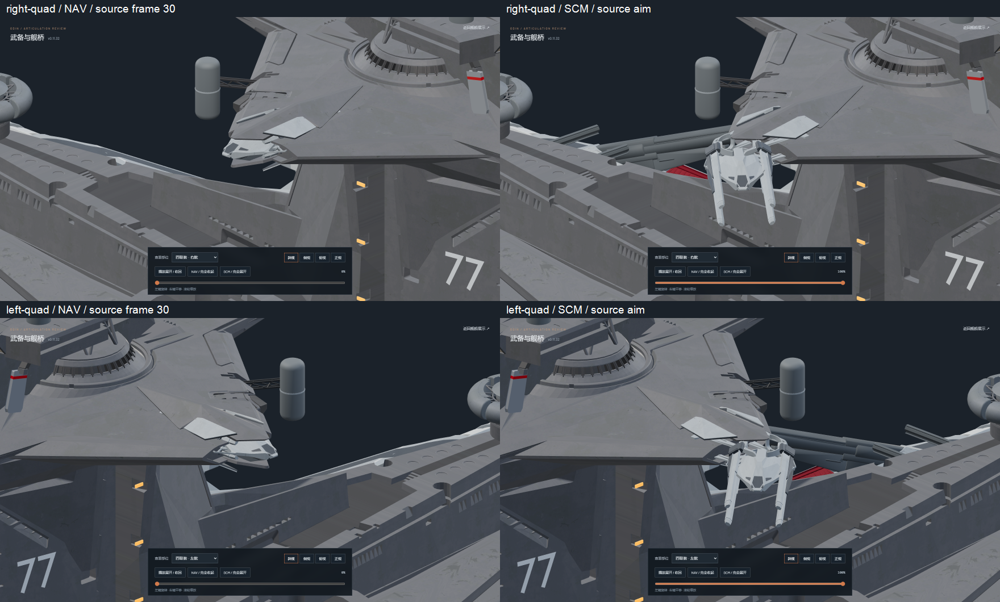
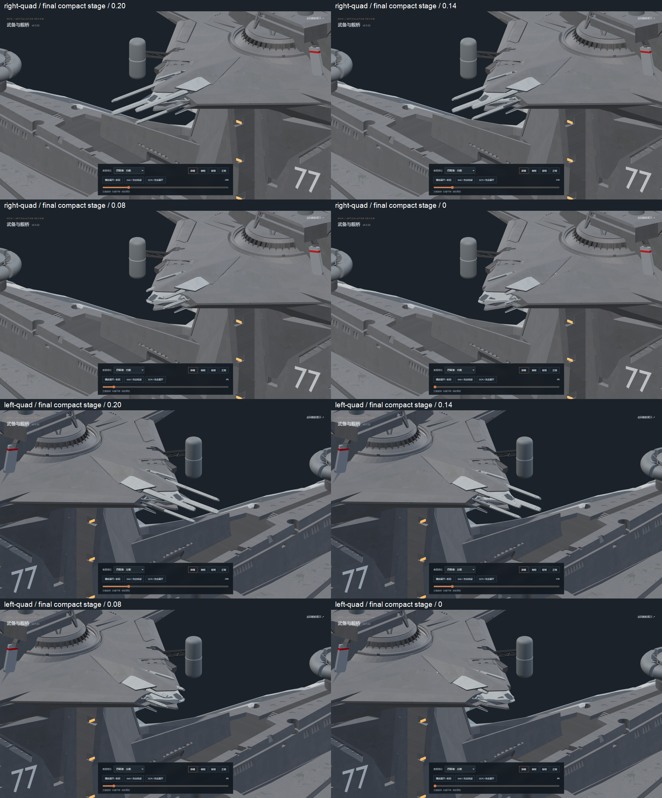
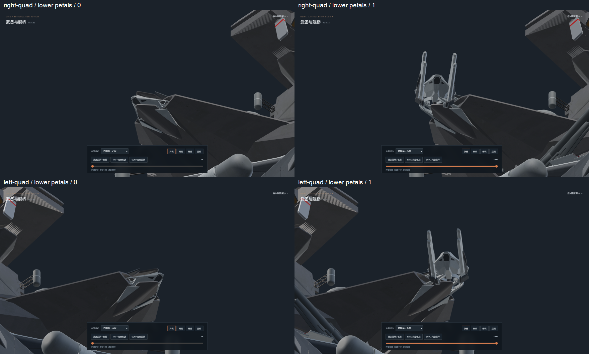
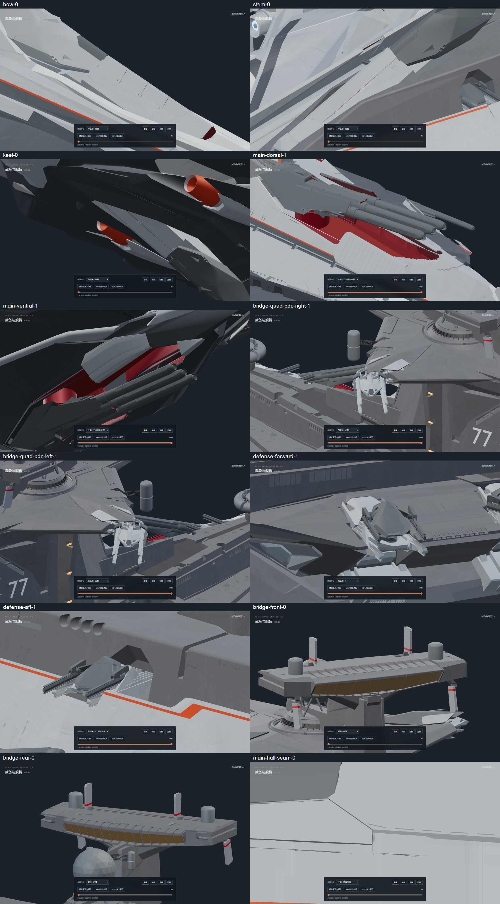

# v0.11.32-rc.1 — shorter quad tube stow and direct armor contraction

Both bridge quad tubes now stop at their previous v0.11.31 11-percent
axial position. The extra slide is 14.40237 source units instead of 32,
reducing the travel and peak slide speed by about 55 percent with the
same final packing interval. The carriage retains its original frame-30
NAV stop and frame-30–45 curve; the original aiming channels remain intact.

The four original gray armor petals per mount have no axial translation
and no clearance excursion. Their original open geometry first aligns
with the original adjoining hull receiver normals during carriage seating,
then moves straight toward the quad cross-section center. Center packing
begins only after the carriage seats. Petals, the radial tube movement and
gray bearings share the center-packing clock. Source creases and materials remain.

The gray bearing center offsets are 1.35 longitudinally and 0.30 vertically;
they retain the ten-unit carriage stroke and receive no additional axial
tube slide. The original gray forks use separate slide guides to retain
their smaller 0.60 longitudinal stroke, so adjacent supports do not cross.
Center packing leads the axial tube slide with a smooth, monotonic curve
inside the same final interval, without overshoot or an outward return.

All original quad geometry, supports, topology and UVs remain unchanged
from the restoration. The original `odin.blend` is unchanged. Editable
static joints are saved in `assets/blender/odin_articulated_v0.11.32.blend`;
animations are authored in Nuxt/Three.js, and both GLBs have zero clips.

Validation:

- `npm test`: 59 tests pass, including the requested reference reach,
  zero forward/backward armor displacement, hull attitude, reversible
  scrubbing, synchronized packing and unchanged other weapons.
- `npm run verify:asset` and `npm run generate`: pass.
- [Source check](source-geometry.json): zero point/UV error across all
  original quad and support surfaces; 494 other meshes and 171 other
  mechanical joints retain the preceding source restoration state.
- [Motion and closure audit](mesh-clearance.json): 802 sampled poses
  with no tube/petal or inter-cradle contacts; each NAV tube tip matches the prior
  11-percent reach within 0.00002 source units. The original slight plate
  crease remains, with receiver-plane deviation below 0.212 source units.
- [Motion metadata](source-restoration.json) records the measured reference
  endpoint, zero axial armor travel, hull normals and center offsets.
- [Browser review](browser-check.json): both mirrors, NAV/SCM, forward and
  reverse travel, lower petals, main guns, singles, defense/PDC and bridge;
  no console errors, explicit pause retained and idle rendering stopped.
  The checking browser is closed; one static preview server remains.
- [Asset hashes](asset-hashes.json) identify the editable and exported files.

