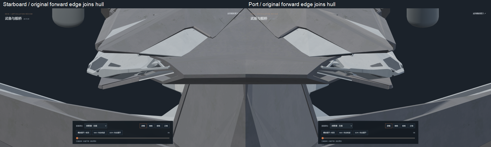
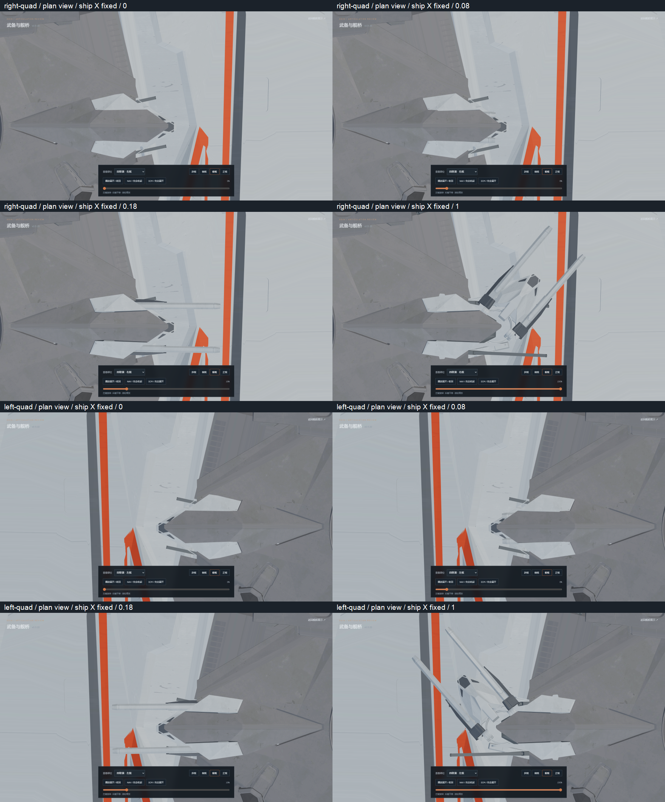
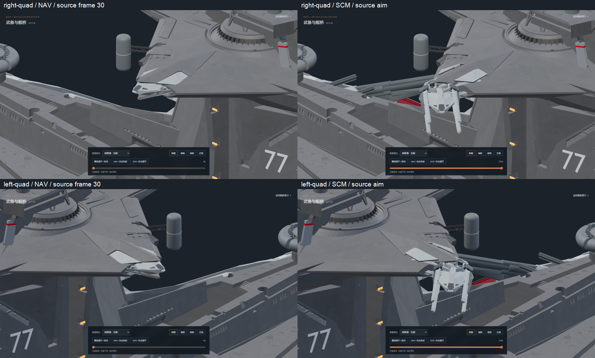
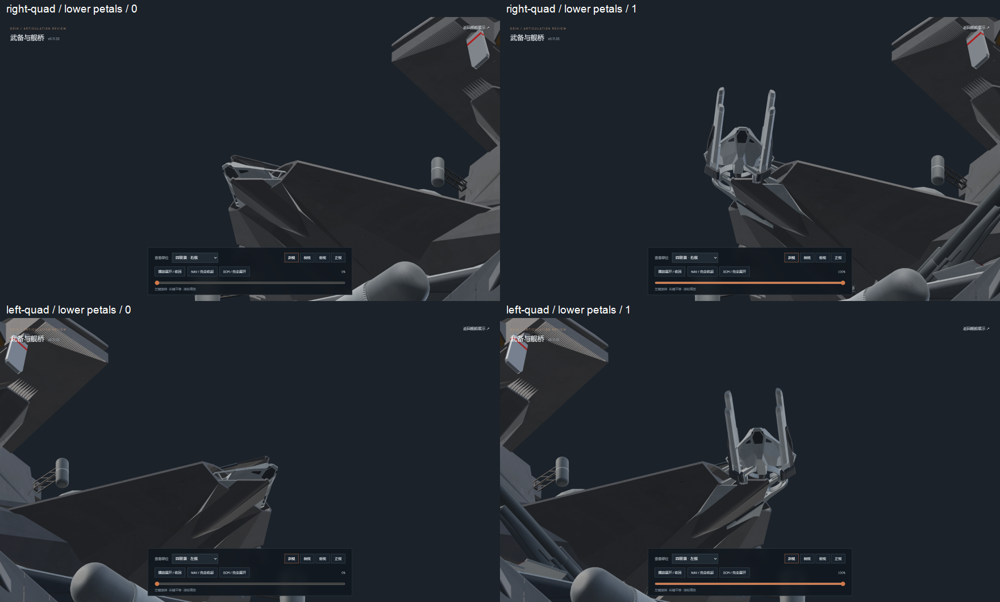
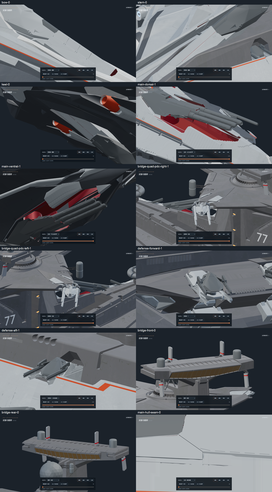

# v0.11.33-rc.1 — translation-only bridge quad armor and connected front edges

Both bridge quad armor banks keep their original orientation throughout the
animation. With the bow defined as positive Y, every armor vertex retains
its ship X coordinate in plan view. This revision removes the former small
receiver-alignment rotation. The fitted armor path uses vertical translation
only; there is no port/starboard or axial slide of the armor.

The eight original 26-vertex gray petals retain their source surfaces,
topology, UVs and open orientation. Their closed forward edges join the
stationary hull lips as continuous lines. Only the four existing lip vertices
at each junction are adjusted, preserving the fixed hull topology and paint;
no replacement armor plates are created. Original `odin.blend` is unchanged.

The full original tubes retain the requested former 11-percent axial reach
and the carriage retains its source frame-30 stop and original aim channels.
The bearings and tubes pack two units longitudinally and 0.30 vertically;
the gray fork guides retain their smaller 0.60 longitudinal stroke. Armor
finishes closing later within the same final packing interval so the tubes
clear its edges. A 0.25-unit vertical allowance during carriage travel clears
the source tube sleeves; the fully open endpoint returns to the source pose.
Every part of that allowance is a translation with unchanged armor X.

Validation:

- `npm test`, `npm run verify:asset` and `npm run generate` pass.
- [Source comparison](source-geometry.json): zero point and UV error for
  the 36 original quad mesh parts; 493 other meshes and 171 other weapon
  joints unchanged. The fixed hull differs only at the 32 documented lip
  vertices; its remaining vertices, topology, UVs and materials are intact.
- [Dense motion audit](mesh-clearance.json): 802 poses on both mirrors,
  zero tube/armor and inter-cradle contacts, zero armor vertex X change and
  zero armor rotation. Forward edge endpoint gaps are below 0.00003 source
  units and line angle differences below 0.001 degrees.
- [Fit records](source-restoration.json) identify the original petal edges,
  original adjoining hull faces, fixed lip edits and translation strokes.
- [Browser review](browser-check.json) covers NAV, SCM, forward and reverse
  travel, top-view X invariance, front-edge close-ups, lower armor, main guns,
  singles, defense/PDC and the bridge. Explicit pause and idle rendering are
  checked. The checking browser is closed; one preview service remains.
- [Hashes](asset-hashes.json) identify the versioned editable Blender file
  and both exported static GLBs, which contain zero animation clips.

