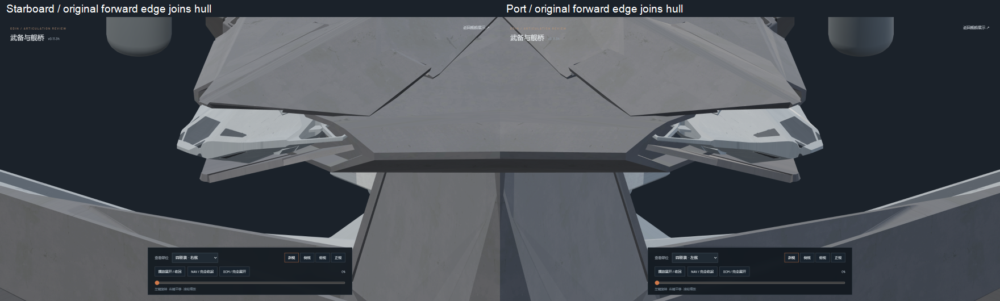
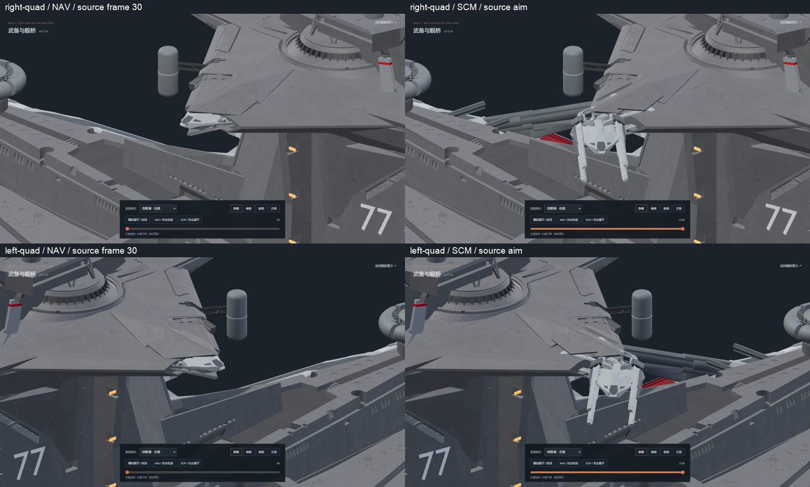
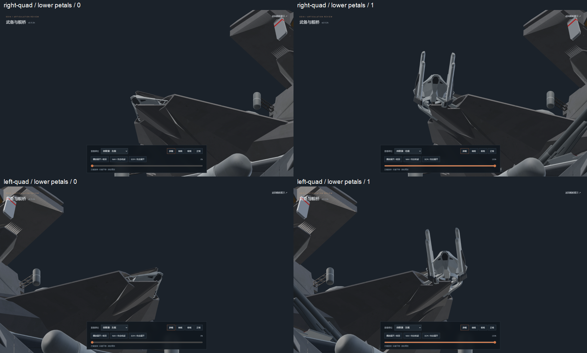

# v0.11.34 — bridge quad roof fit and held opening

The bridge quad armor now makes one vertical translation and holds its open
position from 18% through carriage deployment and aiming. The v0.11.33 passage
allowance no longer expires at 35–60%, so the armor does not descend after rising.
Both mirrors still keep every armor vertex fixed in ship X and never rotate.

All eight original 26-vertex petals retain their source topology, UVs and X/Y
footprint. Their outer skins are fitted in Z to the actual adjoining fixed roof
triangles, with their original vertical thickness retained underneath. The open
clearance is baked into the geometry and included in the single closing stroke.
The source geometry change is recorded per vertex; the largest Z change is
1.074272 source units. The previous 32 fixed lip edits are unchanged. The skins
share the exact `Odin_Bridge_Armor` material datablock of the adjoining roof.

The full original gun and support surfaces remain unchanged, as do the shorter
tube travel, gray cradle/guide packing, source frame-30 carriage stop and aiming
channels. The original `odin.blend` SHA-256 remains
`9ec8b6ee36e6315c7c0cae8576472879518cc5bf48b79382c2affbcbd71af15e`.

Validation:

- `npm test`: 60/60 passed, including monotonic opening, endpoint hold in both
  directions, stale-clearance rejection, every-vertex ship-X lock and roof fit.
- `npm run verify:asset` and `npm run generate`: passed. Both static GLBs contain
  zero animation clips, 196 meshes, 20 materials and 12 embedded textures.
- Independent source verification: 36 recovered source mesh parts; original
  gun/support coordinate error and all source UV errors are zero. All source
  petal X/Y coordinates and topology are retained. 493 unrelated meshes and
  171 other joints are unchanged; the fixed hull outside its 32 recorded lip
  vertices is unchanged.
- Actual mesh sweep: 401 poses per mirror, 802 total; zero barrel/petal contacts,
  zero cradle-pair contacts, zero armor X motion or rotation, zero return stroke
  and zero open-endpoint drift. Maximum closed surface-plane error is
  0.000008762 source units; maximum forward-edge gap is 0.000007630 and maximum
  edge angle error is 0.00001959 degrees.
- Browser: 119 records cover both quad mirrors, forward/reverse transitions,
  lower petals, enlarged roof junctions, plan views, main/secondary batteries,
  defense mounts and bridge. Zero console errors. Explicit pause survives view
  changes; idle rendered-frame count stays at 327. The temporary checking
  browser is closed; one static preview service and one in-app preview remain.

Editable source: `assets/blender/odin_articulated_v0.11.34.blend`.
`source-restoration.json` records the fit; `source-geometry.json` verifies source
preservation; `mesh-clearance.json` records the sweep; `browser-check.json` and
the screenshots record rendered behavior; `asset-hashes.json` fingerprints the
native source and both exported models.

