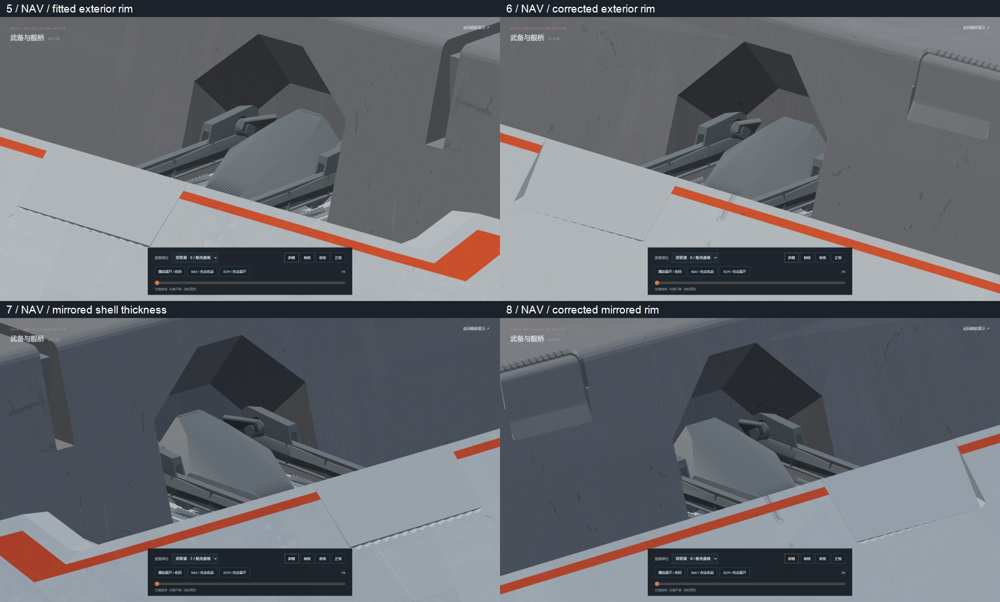
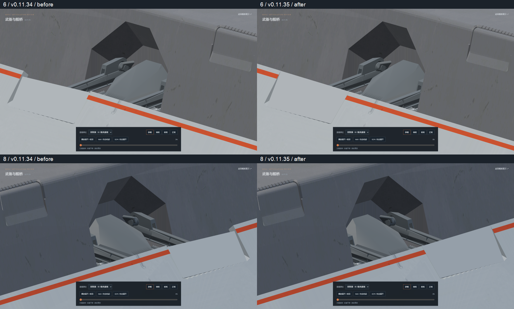
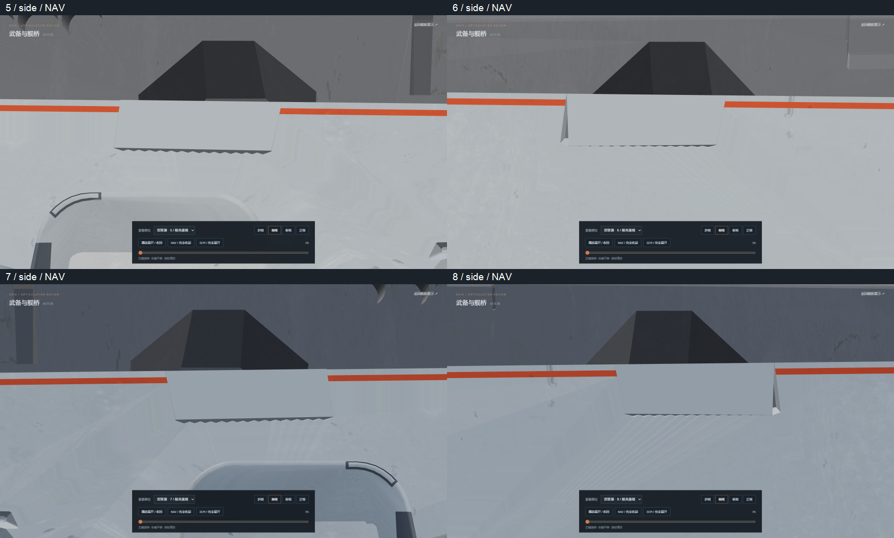
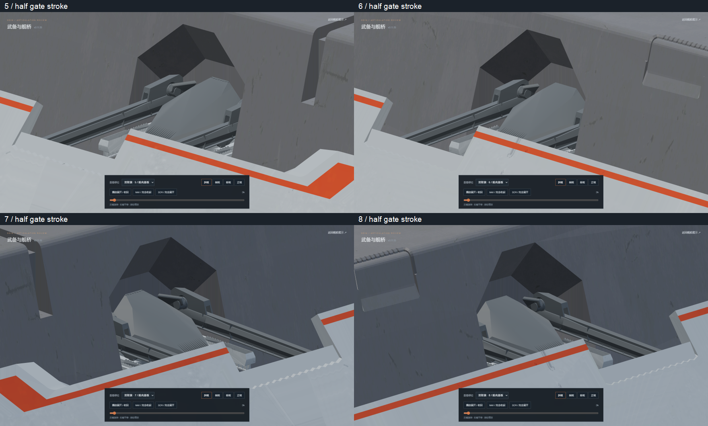

# v0.11.35 — aft twin cover fit and shell thickness

The six/eight aft twin covers previously mixed recessed upper-lip points with
exterior lower-rim points. Their skins were twisted and all four covers used an
arbitrary 0.18-unit thickness. Covers 5–8 now use the actual exterior aperture
corners from `odin.blend / holo.001`, with mirrored planar outer faces and the
measured local shell thickness: 0.534623 source units for 5/7 and 0.523418 for
6/8. The six/eight normals change by 3.558/3.012 degrees.

The perimeter has a 0.012-unit clearance. A small outward seating allowance
places each planar face beyond the source rim's tiny non-planar ridges, with
0.01 source units of additional quantization tolerance. This removes the
fixed rim showing through the closed skin while retaining the original
serrated lip. The four existing eight-vertex, six-face solids retain their
materials and their uniform thickness normal to the exterior plane.

All 528 unrelated meshes, the complete fixed hull, and all 207 static joint
transforms and motion properties are unchanged from v0.11.34. The accepted gate
release/slide, carriage/rail sink and travel, gun elevation and aiming remain
authored in Nuxt. The original `odin.blend` SHA-256 remains
`9ec8b6ee36e6315c7c0cae8576472879518cc5bf48b79382c2affbcbd71af15e`.

Validation:

- `npm test`: 61/61 passed; `npm run verify:asset` and `npm run generate` passed.
- Independent native-source checks confirm measured thickness, planar outer
  faces, mirrored vertices, unchanged fixed geometry and all original joints.
- Actual mesh sweep: 401 poses per gate, 1604 total, plus aiming endpoints.
  Zero gun/cover or rail/cover intersections. Zero fixed-hull contacts through
  the closed exterior. Negative controls detect both omitted carriage sinking
  and omitted exterior seating tolerance.
- Both static GLBs contain zero animation clips, 196 meshes, 20 materials and
  12 embedded textures.
- Browser review covers all four gates, forward/reverse motion, side and plan
  views, plus main/secondary batteries, defense/PDC and bridge regression.
  Explicit pause and idle rendering are checked. See `browser-check.json` for
  the recorded results and resource cleanup.

Editable source: `assets/blender/odin_articulated_v0.11.35.blend`.
The source-rim fixture and `cover-fit.json` record the measurements;
`source-geometry.json` verifies preservation; `mesh-clearance.json` records the
mesh sweep; `asset-hashes.json` fingerprints the native and exported models.

