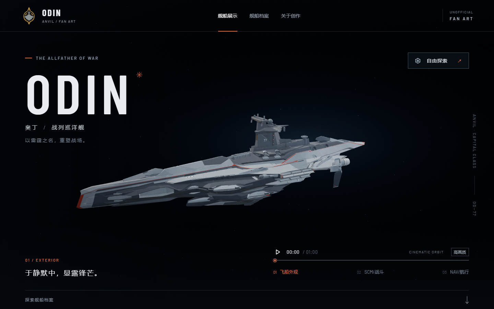

# v0.11.47-rc.1 — Original Odin Founders Club badge

The header now uses the original RSI Odin Founders Club PNG without redrawing, recoloring, cropping, or recompression. The favicon and touch icon are size-only derivatives. Square image boxes preserve the source proportions on desktop and mobile, and versioned URLs avoid stale logo caches.

Source: [RSI badge](https://media.robertsspaceindustries.com/84qwqukbwkgsk/source.png), identified as Odin Founders Club on [the RSI profile](https://robertsspaceindustries.com/en/citizens/twodog0321).

Header SHA-256: `60987981b7d41739304ad8cece78df2bdbd148f370a4dacc347e47941a2d7cfc`. The served header bytes match the original source. The source record and reproducible icon resize script are in `assets/branding/v0.11.47/`.

Validation: all 84 tests pass; `npm run verify:asset` passes with zero GLB animation clips; `npm run generate` succeeds. Browser checks confirm the original 250 × 250 header loads, the 32 × 32 favicon and 180 × 180 touch icon return HTTP 200, and the source attribution links to RSI. Browser console: zero errors, one existing shader precision warning.

Camera, weapon motion, joints, geometry, and materials are unchanged from v0.11.46-rc.1. The regression suite covers main and secondary batteries, PDC mounts, bridge quad gun arms and bridge armor.

The temporary checking browser was closed. One preview service remains; no background Blender jobs remain. The user preview was updated to v0.11.47-rc.1 and left paused at the opening frame.

