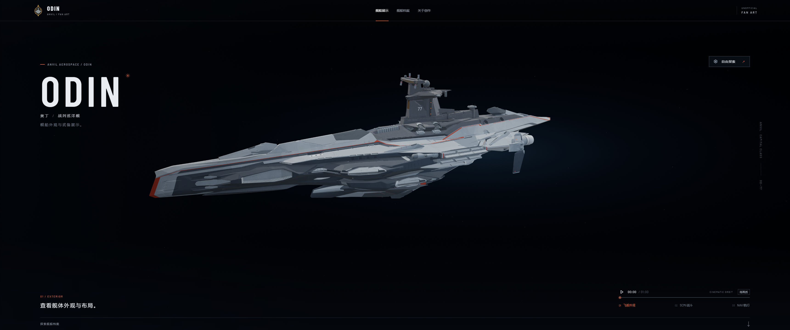

# v0.11.48-rc.1 — Steady orbit, ultrawide framing and plain copy

The camera now follows a steady orbit with a fixed viewing angle, distance and aim. The previous sequence combined rotation with repeated zooms, elevation changes and target shifts. The 45-second clockwise orbit keeps its independent clock and its uniform eight-degree-per-second speed. Automatic hull roll and background drift are removed. Chapter changes and returns from free exploration follow an arc around the ship instead of a straight chord through it.

Ultrawide framing brings the camera closer while preserving its viewing angle, and lifts the enlarged silhouette away from playback controls. The previous 1200-pixel hero-height cap is removed so tall ultrawide displays use their full viewport height. At the opening view, the projected ship width increases by 29% on 2560 × 1080 and 51% on 32:9, compared with v0.11.47. The ship occupies approximately 51% and 40% of the screen width respectively. Exact percentages vary with viewing direction.

Page copy now describes the ship and controls directly. The three captions read “查看舰体外观与布局。”, “武备展开，切换至战斗配置。” and “武备收起，切换至航行配置。”. The hero, loading state, dossier, specification descriptions, concept-art heading and project description use the same restrained tone.

Validation: all 85 tests pass; `npm run verify:asset` passes for both models with zero animation clips; `npm run generate` succeeds. Camera tests cover stable framing, one-way uniform motion across camera and film loops, useful ultrawide screen coverage, and opposite-side transitions that stay outside the hull.

The camera projection audit decodes all 2,485,705 exported vertex instances and evaluates 273 poses per configuration across the full orbit and three deployment states. Desktop 16:9, 21:9, 32:9 and portrait configurations have zero clipped hull samples. See `camera-verification.json`. Browser checks cover 18 rendered views at 1440 × 900, 2560 × 1080 and 3200 × 900, plus exterior, combat and navigation views at 3440 × 1440. The hero uses the full 1440-pixel height. Both natural camera and weapon-film wraps preserve direction, height, aim and speed; explicit pause survives seeking, mode changes and chapter changes. Browser console has zero errors. Screenshots, a contact sheet and recorded loop checks are alongside this note.

The official founder badge, original Blender file, editable geometry, both GLBs, materials, joints and weapon animation trajectories are unchanged. Mechanical regression checks include main guns, single and twin secondary batteries, PDC mounts, bridge quad gun arms and bridge armor.

The temporary checking browser and camera audit have ended. One user-facing preview service remains, with the updated page paused at the opening frame. No background Blender jobs remain.

