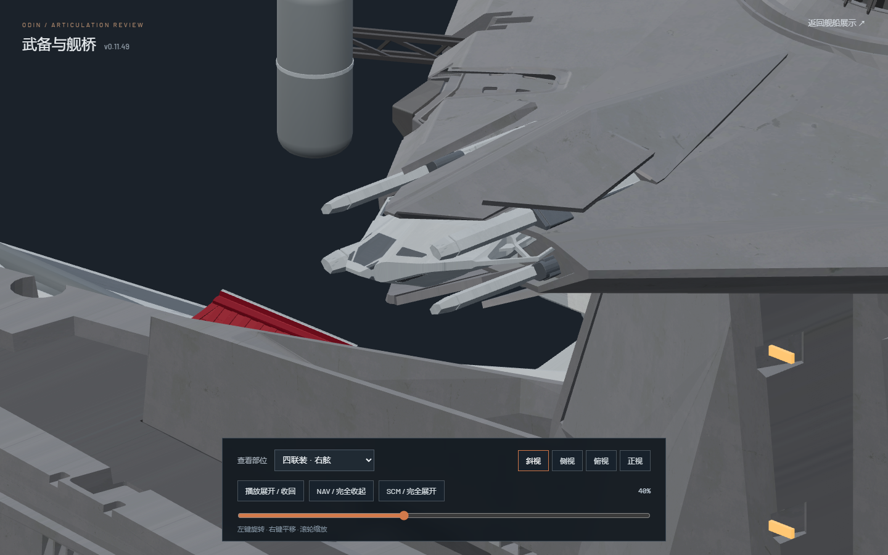

# v0.11.49-rc.1 — Shallow bridge quad packing without casing penetration

Both bridge quad turrets now close with a small side-view horizontal stroke. Model Y packing falls from 1.98 to 0.495 source units per tube, a 75% reduction. Model Z packing increases only slightly, from 0.30 to 0.32, staying below the adjacent gray bearing contact limit. The closed tube-center fore/aft gap is approximately 7.50 units instead of 4.53. No rotation is added to the tubes or armor.

The wider spacing would intersect the existing closing skins if the old axial timing and seat were retained. The tubes therefore withdraw along their own axes before final armor closure, with an additional 8-unit seating clearance. Their smooth axial stroke spans 8%–69% of the timeline, extending through the released opening alongside the carriage instead of racing through the short packing phase. The original frame-30 carriage seat, aiming, four armor trajectories and 6.5-second stroke duration remain unchanged. Gray bearings do not receive the additional axial withdrawal; their long guides compensate to retain their accepted world trajectories.

`motion-verification.json` compares 233 actual Nuxt poses with v0.11.48. All 199 unaffected joint world trajectories remain identical within floating-point precision, including main batteries, single/twin secondary batteries, defense mounts, quad guides, bridge armor and supports. The eight cradle positions and eight tube positions are the only changed joint world trajectories. All joint rotations and fully deployed endpoints are unchanged.

`mesh-clearance.json` tests 202 forward and 31 reverse poses per side against the unchanged editable model. Actual barrel/casing, barrel/armor, barrel/barrel and neighboring complete bearing/fork surfaces have zero contacts. The same audit detects the prior barrel/casing penetration as a positive control. Code, native geometry and both GLB hashes bind the evidence to this revision. Reproduce with `node --experimental-strip-types tools/sample_bridge_quad_packing_v01149.mjs`, followed by two-thread background Blender running `tools/audit_bridge_quad_packing_v01149.py` in `assets/blender/odin_articulated_v0.11.43.blend`.

All 550 original exported mesh parts, materials, UVs, textures and static rest joints remain unchanged. The original `odin.blend` and the versioned editable file are unchanged; no native geometry rewrite or GLB re-export is needed. Both exports contain zero animation clips. Animation is authored in Nuxt/Three.js.

Validation: 86 tests, `npm run verify:asset` and `npm run generate` pass. Speed regression limits still pass: tube release stays under 11 source units/second and below 1.25 times the carriage's peak speed. Browser review covers both quads in four views, main batteries, secondary singles and twins, defense covers, bridge armor and supports. Both quads complete opening/closing playback loops. The main website renders exterior, combat and navigation states, and its explicit pause persists across seeking and free-exploration mode changes. Explicit review pause holds and produces zero additional rendered frames. Console has zero errors and warnings. The temporary browser is closed and no Blender checks remain; one user preview remains paused on the right quad at 40% deployment.

