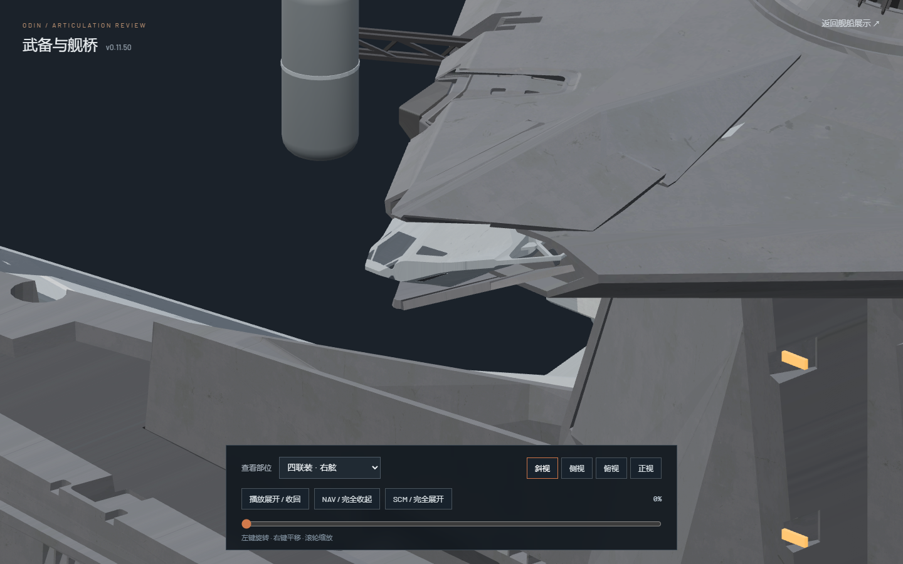

# v0.11.50-rc.1 — Seat bridge quad receiver tails inside the closed hull

The lower gray receiver corners on both bridge quads protruded beyond the sloped closed hull even after the previous reduction in barrel packing. The roof-envelope check now includes the original receiver shells, rather than checking only tubes against the casing and moving armor. It detects the v0.11.49 lower-shell protrusion as a positive control: approximately 0.260 and 0.118 source model units.

Side-view horizontal packing increases slightly from 0.495 to 0.670 source units per tube. The tube vertical half-stroke increases from 0.32 to 0.40. A shared 0.20 model-Z stow datum seats the receivers within the asymmetric upper/lower roof planes. The bearing vertical half-stroke remains 0.32 to avoid squeezing opposite gray bearings together; each tube receives only the additional 0.08 vertical half-stroke inside its receiver. Long guide compensation preserves the complete accepted fork trajectories.

The closed tube-center horizontal gap remains approximately 7.144 units; upper/lower separation is approximately 2.413. All eight original receiver shells are inside their fitted roof planes, with a minimum vertical margin of 0.0166 units. This is an animation-only adjustment: geometry, materials, UVs, textures and static rest joints are unchanged. The original `odin.blend`, editable v0.11.43 file and both GLBs are unchanged. Both exports contain zero animation clips.

Axial travel remains exactly 22.40237037037 source units on the existing 8%–69% timeline interval. Carriage travel, aiming, four armor trajectories, release clock and 6.5-second playback stroke retain their accepted timing. The fully deployed pose and every joint rotation remain unchanged.

`motion-verification.json` compares 233 actual Nuxt poses against v0.11.49-rc.2. All 199 unaffected joint world trajectories match within 2.23e-16, including main batteries, secondary singles/twins, defense mounts, quad guides, bridge armor and supports. Only eight cradle and eight tube joint world paths change. `mesh-clearance.json` checks 202 forward and 31 reverse poses per side. Tube/casing, tube/armor, tube/tube and neighboring bearing/fork surfaces have zero contacts. The additional closed-hull envelope test verifies the original receiver, tube and fork vertices against all four roof seats on both mirrors.

Reproduce with `node --experimental-strip-types tools/sample_bridge_quad_packing_v01150.mjs`, then run `tools/audit_bridge_quad_packing_v01150.py` in two-thread background Blender with `assets/blender/odin_articulated_v0.11.43.blend`. The audit never saves the native file. Evidence includes normalized text hashes, binary asset/native hashes and the recorded runtime-pose hash.

Validation: all 86 tests, `npm run verify:asset` and `npm run generate` pass. Browser review covers both quad turrets in four views, closed/intermediate/open poses, both complete playback directions, and main batteries, single/twin secondaries, defense gates, bridge armor and supports. Explicit pause holds with zero additional review render frames; the main website preserves pause across seeking and mode changes. There are no application errors. The initial browser launch produced one ANGLE shader precision warning (X4122); the capture and playback runs have no application warnings. The temporary test browser and Blender audit processes are closed. One user preview remains paused at 0% on the right quad.

