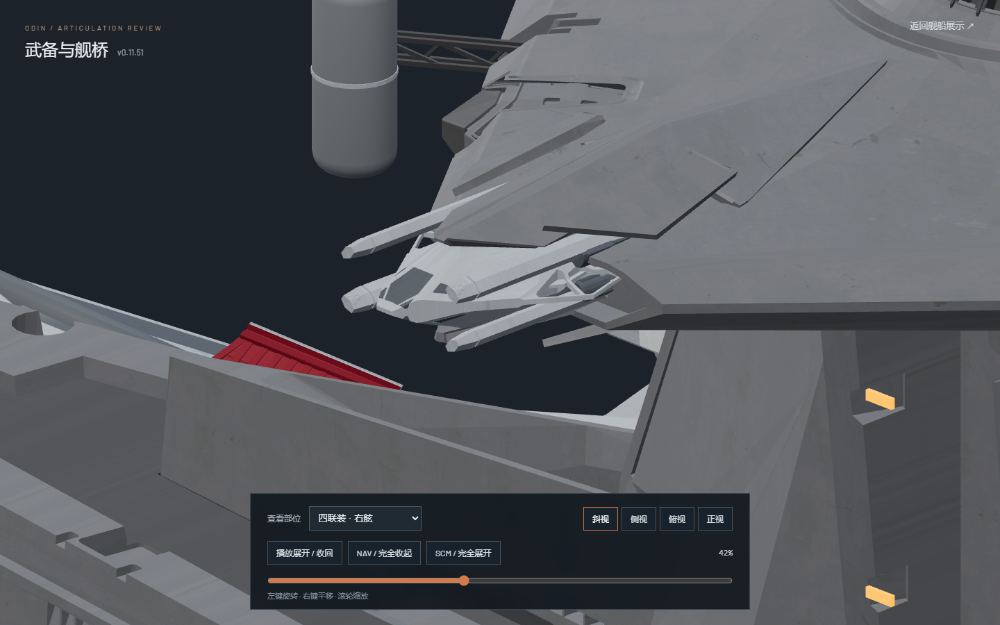

# v0.11.51-rc.1 — Extend bridge quad tubes before spreading

Both bridge quad turrets now keep their tubes gathered during the initial axial extension. Spreading starts at 42% of the actual timeline, after reaching the previous revision's 42% axial seat, and finishes smoothly at 64%. Reversing gathers the tubes before the final axial withdrawal. The original 22.40237037037-unit axial stroke and its 8%–69% clock are unchanged, as are carriage travel, aiming, four hull-armor trajectories and the 6.5-second playback stroke.

The new straight passage cannot use the former tube packing unchanged: its lower aft tube would cross the central casing during extension. Tube horizontal packing therefore changes slightly from 0.67 to 0.60 source units and vertical half-stroke from 0.40 to 0.32. This retains wide tube spacing while clearing the initial straight corridor. The original gray receivers keep their fitted 0.20 model-Z datum and 0.32 vertical half-stroke.

The fixed hull lip also narrows along the carriage's outward path. Receiver shelves remain seated while passing that lip; a bounded additional 1.20-unit inward receiver stroke develops over 35%–50% and releases over 60%–69%, before original aiming begins. Tube and long-fork compensation keeps these receiver adjustments out of their own world trajectories: tubes remain purely axial through 42%, while all long forks follow their accepted paths. No new rotation is added. The fully deployed pose is unchanged.

`motion-verification.json` compares 233 actual Nuxt poses against v0.11.50-rc.1. It verifies zero early tube spreading through 42%, unchanged axial travel/timing, unchanged deployed endpoints and 199 unchanged joint world paths. Main batteries, secondary singles/twins, defense mounts, bridge armor/supports and long quad forks retain their existing trajectories.

`mesh-clearance.json` checks 202 forward and 31 reverse poses per side. Tube/casing, tube/armor, tube/tube and neighboring receiver/fork surfaces have zero contacts. It additionally identifies the actual adjacent outer hull roof triangles and checks receiver entry/exit through 69%, before unchanged original aiming. This detects 78 affected forward poses per side in the prior revision, including the crossing leading into the reported 30% protrusion, and zero in the new route. The original fitted closed-hull envelopes also retain their inside margins. Internal mounting surfaces and the unchanged later source aiming path are outside this specific fixed-roof entry/exit check.

Reproduce using `node --experimental-strip-types tools/sample_bridge_quad_packing_v01151.mjs`, then run two-thread background Blender with `assets/blender/odin_articulated_v0.11.43.blend`, `--python-exit-code 1` and `tools/audit_bridge_quad_packing_v01151.py`. Hashes bind actual poses, normalized source text, native geometry and both GLBs. The audit never edits or saves native geometry. The original `odin.blend`, editable v0.11.43 model, geometry/materials/UVs/textures and zero-animation GLBs remain unchanged; this revision authors animation only in Nuxt/Three.js.

Validation: 86 tests, `npm run verify:asset` and `npm run generate` pass. Browser review includes both quads in four views at 0%, 30%, 42%, 50%, 64% and 100%, both complete opening/closing loops, and other batteries, defense gates, bridge armor and supports. Explicit review pause holds with zero extra render frames. Main-page pause persists across seeking and mode changes. There are no application errors; initial browser launch produced the existing ANGLE shader precision warning X4122. Temporary test browser and Blender checks are closed. One user preview remains paused at 42% on the right quad.

