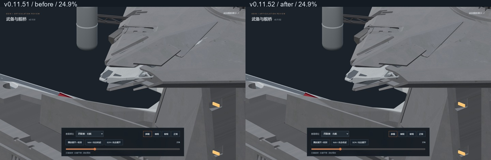

# v0.11.52-rc.1 — Quad tube roof clearance and shallow receiver travel

The white corner reported at 24.9% is the upper aft tube (`PDC_Starboard_ArmMesh_3`), protruding through the curved bridge roof. It was not a hull petal or a receiver. The previous seam-plane audit did not cover this rendered surface. Browser ray picking now identifies and verifies the actual exported tube and fixed hull at the reported pixels.

Both quads use 0.65 source units of upper/lower tube packing, centered on the original tube datum, instead of a 0.32 half-stroke plus a +0.20 Z shift. Horizontal packing reduces from 0.60 to 0.40 units to preserve casing clearance during the deeper vertical passage. The four tubes retain 1.915 units of vertical separation in the compact pose. Axial travel, its 8%–69% timing and spreading at 42%–64% remain unchanged.

The additional 1.20-unit inward receiver detour has been removed. Receivers retain their shallow 0.67 horizontal stroke and 0.32 vertical half-stroke about their fitted datum. They no longer gather further into the casing and then return. The long forks retain their previous world paths through local compensation.

Ray picking also identified a separate small white corner at 50% as the original support, not a barrel. Its mounting position is lowered by a constant 0.35 source units. This does not introduce a support animation: it follows the existing carriage throughout, with no separate withdrawal, lift or late settling stroke. Native vertices, UVs, materials, joints, original `odin.blend`, the editable v0.11.43 file and both zero-animation GLBs are unchanged.

Validation includes 86 tests, `npm run verify:asset`, `npm run generate`, 233 actual forward/reverse Nuxt poses per mirror, and browser checks in four views at 0%, 24.9%, 30%, 35%, 42%, 50%, 60%, 64% and 100%. Tube/casing, tube/armor, tube/tube and neighboring receiver/fork checks have zero contacts; closed tube and receiver envelopes retain positive margins. Both complete playback directions, other batteries, defense mounts and bridge structures were rechecked. Explicit review pause renders zero additional frames; main-page pause survives seeking and mode switches.

`browser-verification.json` contains ray-pick regression evidence at the reported tube corner and the support corner. Reconstructing their previous local offsets at the same camera/time produces the visible source mesh at all six probe pixels. With production offsets, the fixed hull is nearest at those pixels. This supplements visual inspection of the full animation; it is not a claim of exhaustive contact-free geometry for every internal source mounting surface.

The native report retains the older adjacent seam-plane receiver diagnostic for transparency. Those limited planes are not a complete model of the exported curved bridge roof, and the deliberately embedded source mounting surfaces are not treated as a universal zero-contact criterion. The changed visible roof crossings are checked against the actual exported geometry in the browser, rather than justified by an extra receiver detour.

Reproduce pose and mesh checks with `node --experimental-strip-types tools/sample_bridge_quad_packing_v01152.mjs`, then two-thread background Blender with `assets/blender/odin_articulated_v0.11.43.blend`, `--python-exit-code 1` and `tools/audit_bridge_quad_packing_v01152.py`. The artifacts bind normalized source hashes, native geometry and both GLBs. The native audit never saves or modifies source geometry.

