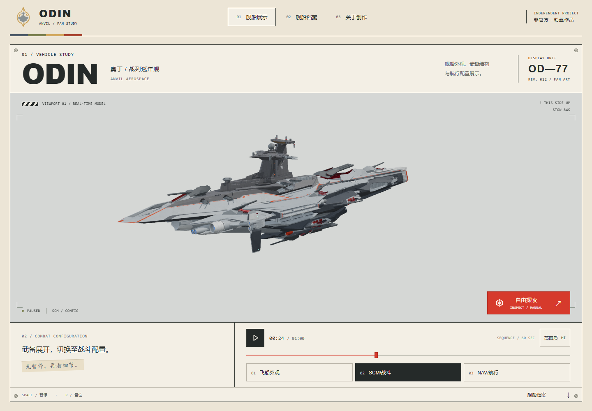
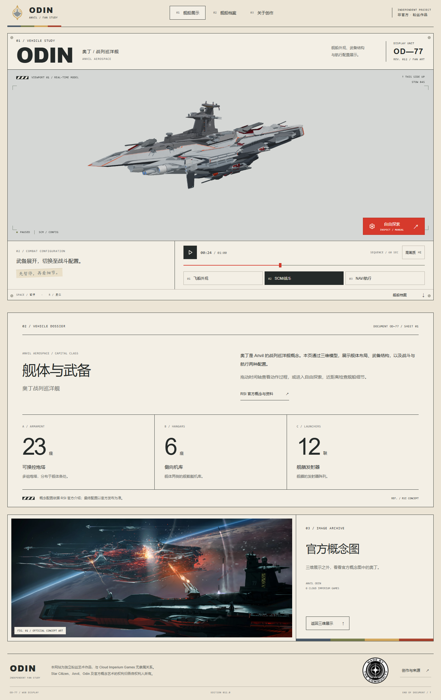
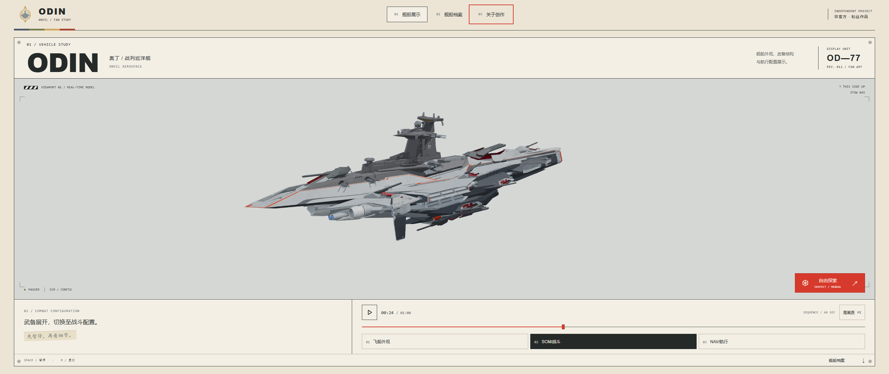
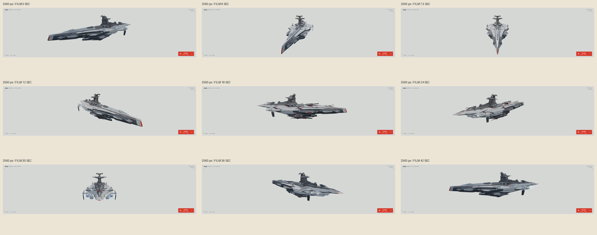

# v0.12.0-rc.1 — NASA-punk presentation preview

The site now reads as a light spacecraft equipment display: a bolted model viewport, a separate control panel, manual-style dossier sheets, and a mounted concept-art photograph. This revision starts from merged PR #73 (`b2755cc9a0e21ad3bc3f5458bc2f9688a7142b76`, released as `v0.11.52`).

## Visual design

| Element | Treatment |
| --- | --- |
| Enclosure | Warm cream `#ECE5D6`, light panels, gray model well, thin ink seams and slotted fasteners |
| Identity | Original Odin Founders Club badge; muted stripes `#4C5A68`, `#7A7F4E`, `#D2A85E`, `#A8432F` |
| Controls | Red `#D63A2C` on the main inspection button and timeline; black/cream secondary controls |
| Labels | Helvetica/Arial and system monospace, uppercase serials, direction marks and hazard stripes |
| Wear | Sparse static SVG edge scratches and a small handwritten operator note |

The dossier, footer, source dialog, mobile layout and articulation review use the same panel language. The original ship paint and physical engine effects remain intact. The model well uses a flat neutral background without the former starfield, screen-wide halo, vignette or animated grain. The viewing lens is fixed at 28° on PC and 34° on mobile to suit the shorter enclosed viewport; the accepted orbit, clock, controls and all rig trajectories are unchanged.

References: [NASA Graphics Standards Manual, 1976](https://www.nasa.gov/wp-content/uploads/2015/01/nasa_graphics_manual_nhb_1430-2_jan_1976.pdf) and [Bethesda's official Starfield gameplay reveal](https://bethesda.net/en-US/news/starfield-gameplay-reveal).

## Validation

- `npm test`: 86 passed.
- `npm run verify:asset`: both GLBs valid, 214 meshes each and zero animation clips.
- `npm run generate`: passed.
- Browser: desktop 1440×1000, ultrawide 2560×1080, and fresh mobile 390×844 load. No overflow across ten widths from 320 to 3440 pixels; high-resolution PC and lite mobile assets both load.
- Playback, explicit pause, chapter seeking, manual orbit/pan, NAV/SCM switching, quality switching, dialog close and navigation passed. Holding the timeline keeps 23.90 seconds fixed; release resumes to 24.26 seconds.
- Eighteen rendered orbit poses include the exact head-on bow angle; the complete silhouette stays inside the model well. The 13 articulation stations were rendered at 0%, 50% and 100%, including main batteries, mirrored secondary 2/4, quad/PDC arms, forward and aft twin defense mounts, and the bridge. All 215 joints remain available.
- Rig, tempo, source camera path, geometry, textures and original badge have no diff against the merged mechanical baseline. No Blender model was edited or exported.
- Temporary QA browser is closed after capture; one user-facing preview remains.

Raw results: [browser-check.json](browser-check.json).

