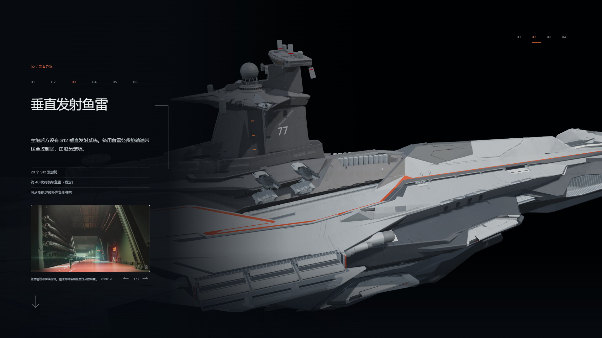
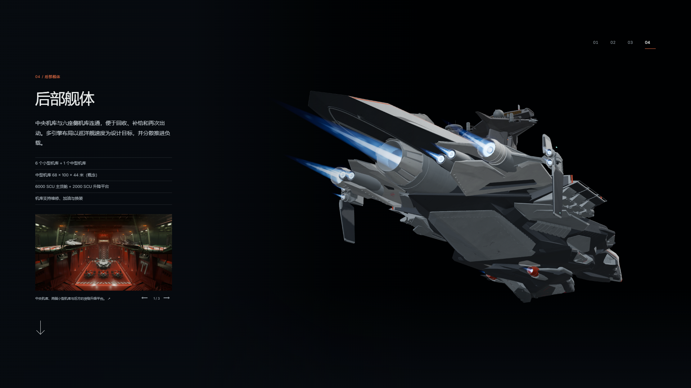
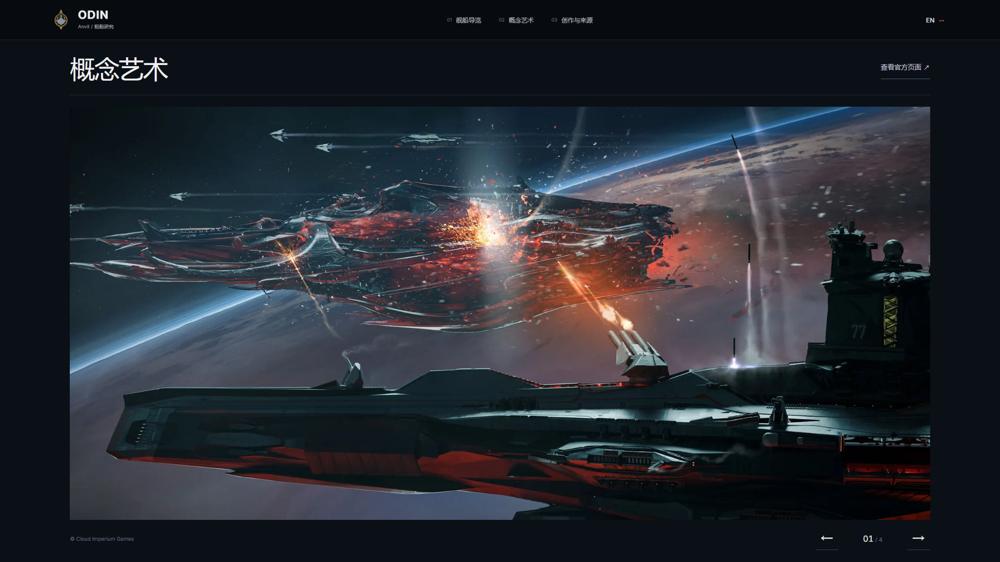
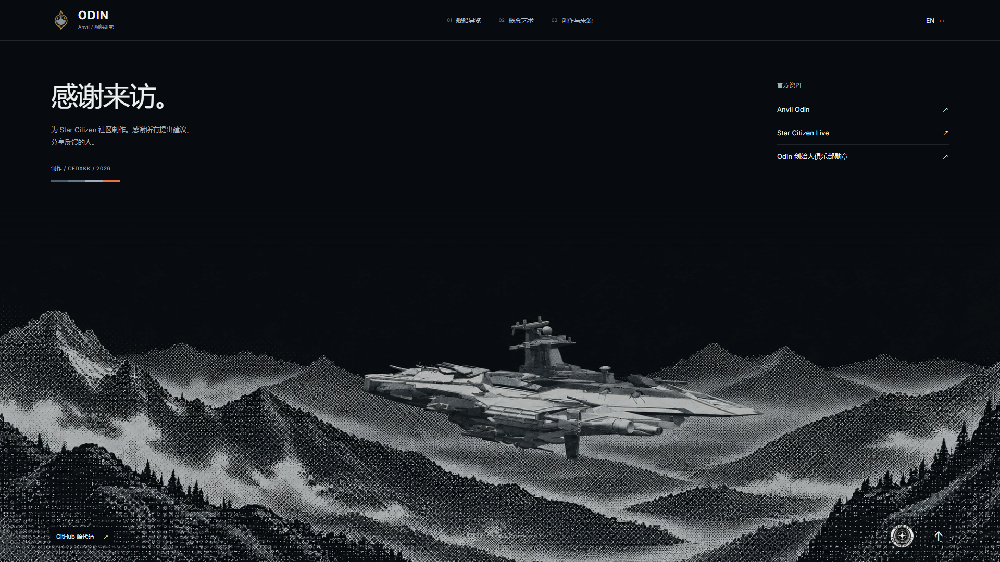

# v0.18.0 — guided inspection and free-view polish

Candidate: `v0.18.0-rc.1`, branch `codex/odin-tour-polish-v0.18.0`.

The homepage now keeps the view toggle in a reserved position, labels NAV/SCM in both languages, preserves explicit pause through mode changes, and blends the actual visible weapon/exhaust state when returning to the guide. The visual progress indicator rewinds over 650 ms at the loop boundary. Free view exports a transparent supersampled PNG without the interface.

The six weapon stops use a horizontal, slightly bow-up framing. A single Three.js overlay renders the complete animated connector, including branches to both main batteries. Torpedo loading follows the main-battery stop; the single-gun view includes more of the hull, and the incorrect PDC clip has been removed from the twin-gun stop. Local video posters match the first decoded frame exactly.

Bridge and aft views include their surrounding hull. Official concept imagery and bilingual descriptions cover torpedo loading, living/medical spaces, cargo, hangars and propulsion. [Source records](sources.json) distinguish announced concepts from fixed specifications and retain SCL timestamps. Full video transcripts are not redistributed.

The gallery reserves viewport space for its navigation. The footer retains the user's selected black background and the clearer original ship, removes the duplicate identity and invented hull label, and includes GitHub and the community badge. The user chose this direction after comparing the historical pale and dark variants. [Image prompt and provenance](footer-image-prompt.txt).

## Validation

- `npm test`: 122 passed.
- `npm run verify:asset`: both GLBs valid; each has 214 meshes, 20 materials, 12 embedded textures and zero animation clips.
- `npm run generate`: passed.
- [Scene checks](scene-qa-summary.json): 43 passed across multiple browser runs, covering camera continuity, interrupted mode changes, pause/scrubbing, loop rewind, dual callouts and photo alpha. The last scene follow-up and phase checks loaded a fresh build with distinct query strings; subsequent edits affected copy and layout, not those scene helpers.
- Layout reviewed in Chinese and English at 1920×1080, 2560×1080, 2560×1000, 3440×1440, 1366×768, 390×844 and 800×600. Final [short-screen checks](short-screen-final.json) cover all 18 interior-image/language combinations, with arrows and image controls inside the viewport and no horizontal overflow.
- [Video hover checks](media-hover-qa.json): idle clips stay paused, hover starts playback and removes grayscale, leaving pauses playback, mirrored main/quad clips retain their transform.
- The transparent photo check produced a 2880×2000 PNG with transparent corners, visible ship/flames, and unchanged live camera/mechanics.

No Blender source, GLB, rig geometry or articulation timing was changed in this revision.

## Preview captures

