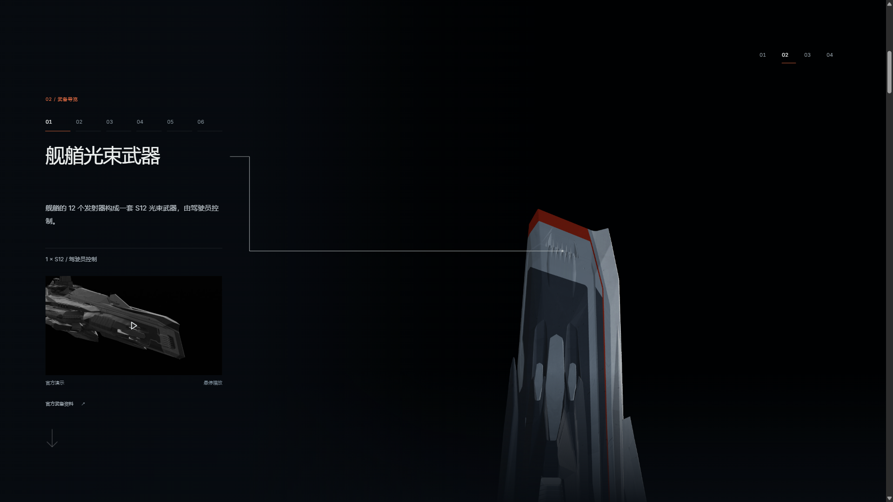
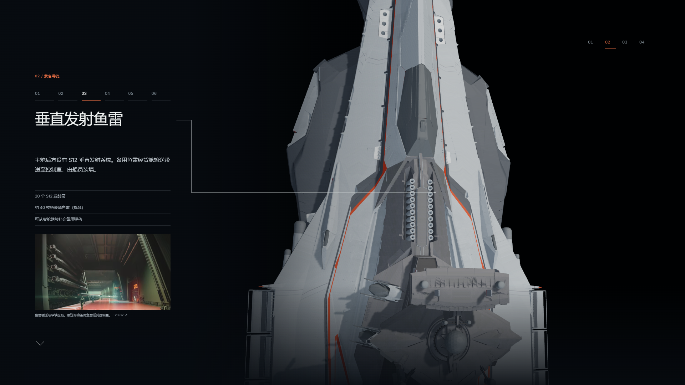
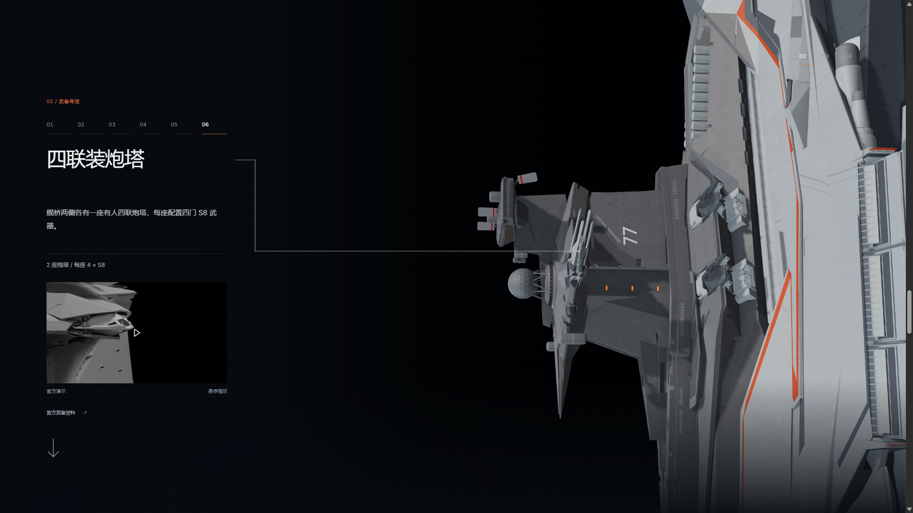
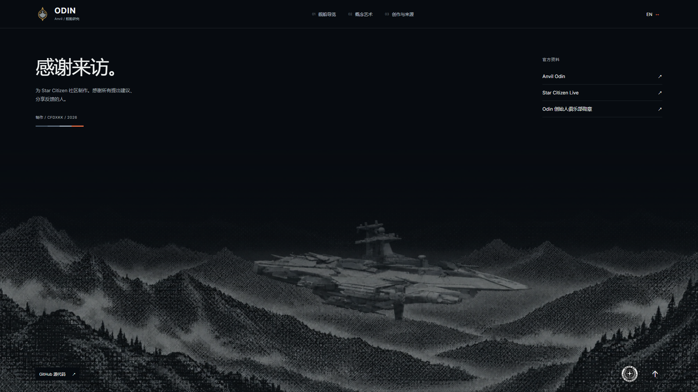

# v0.19.0 — continuous weapon inspection

Candidate: `v0.19.0-rc.1`, branch `codex/odin-continuous-inspection-v0.19.0`.

Clicking the homepage timeline now moves weapons and exhaust from their actual visible pose to the requested frame over a bounded transition. Repeated clicks retarget the in-between pose, while a real slider drag remains direct. Explicit pause and playback intent survive both actions; the camera also moves to the chosen frame.

The weapon chapter uses native continuous scrolling through a 650svh sticky section. Bow stays screen-up. The camera follows the six weapon stations while crossing from port, over the dorsal hull, to starboard. Text stays pinned, station buttons scroll to the corresponding position, and reverse scrolling follows the same path. Weapon-family deployment remains independent of the continuous camera, so only the currently described family opens. Other chapters retain staged navigation. Both main-battery anchors remain connected; the ventral gun is naturally partly hidden while the camera passes above the hull.

The vertical torpedo image, the third bridge image, and the second and third aft images are removed from their galleries. The two remaining SCL frames use explicit crop bounds in both the inline image and the native-dialog enlargement. Source images remain untouched, with official links and timestamps preserved. The dialog blocks background wheel/touch/key scrolling and returns focus on close. See [media cleanup](media-cleanup.json) and [browser checks](media-browser-qa.json).

The black footer keeps the recognizable ship, reduces fine detail and contrast, and softens the complete ship-and-mountain image together. A gradual top mask makes the distant ridges faint. Official links, GitHub and the community badge remain visible. The image-generation iterations, rejected variants and selected asset are documented in [prompt and provenance](footer-image-prompt.txt).

## Validation

- `npm test`: 129 passed.
- `npm run verify:asset`: both GLBs valid, each with 214 meshes, 20 materials, 12 embedded textures and zero animation clips.
- `npm run generate`: passed. The initial sandbox attempt could not resolve the installed Draco WASM path; the normal build passed with the filesystem restriction lifted.
- [Scene browser checks](scene-qa-summary.json): 25 passed, covering real mouse clicks, interrupted seeks, pause, drag, all six weapon stations, native wheel progression, reverse navigation, over-hull orbit and dual main callouts. Three early chapter-entry assertions were repeated after waiting for the actual new view; the report records that correction.
- [Layout checks](layout-browser-qa.json): Chinese/English at 1920×1080, 2560×1080, 3440×1440, 1366×768, 800×600 and 390×844. Weapon copy/arrows, gallery controls and footer links remain inside the viewport; no horizontal overflow or runtime errors.
- Media dialogs checked at 1920×1080, 800×600 and 390×844, including crop, source links, Escape, close button, focus restoration and background-scroll isolation.

No Blender source, GLB, material, joint or mechanical articulation path was changed.

## Captures

