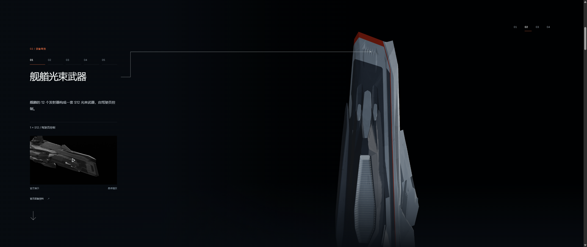
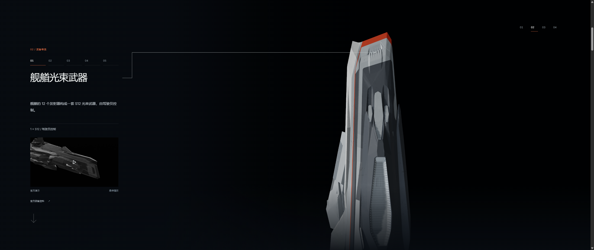
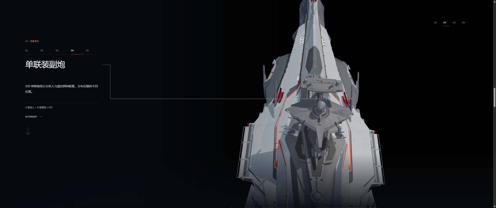
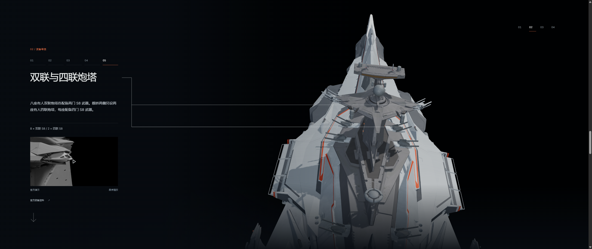
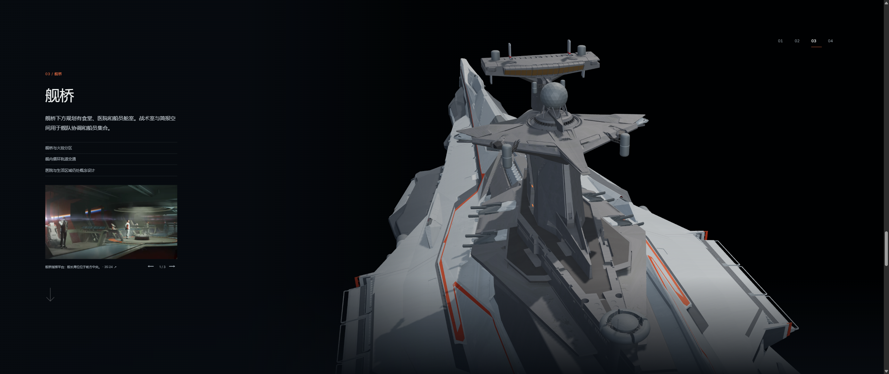
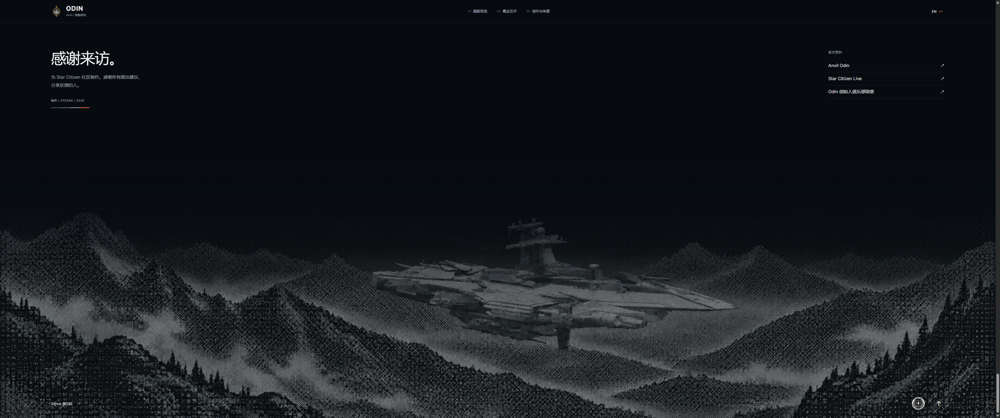

# v0.20.0 — side-aware entry and aft inspection

Candidate: `v0.20.0-rc.1`, branch `codex/odin-camera-handoff-v0.20.0`.

The weapon chapter chooses its entry side from the actual rendered homepage camera. Camera orientation and position move along one shortest quaternion arc, so entering from the opposite side does not add a full revolution or a roll. Reverse navigation retains the chosen route.

The bow remains screen-up throughout continuous inspection. Around the torpedo station, the lateral sweep slows while the aft pitch begins; their easing windows overlap before lateral motion stops. The single-gun view looks down from the aft dorsal quarter. Twin and quad turrets share the fifth station, deploy together, and receive two callout branches. The bridge continues from the same aft hemisphere instead of returning to a front-side shot. The section is now 550svh for five stations, preserving approximately the previous scroll distance per station.

The first shot's focus moves aft, from source Y369.5 to Y300, and its distance increases slightly from 4.1 to 4.5 to include the bow weapon's cooling structure. Route angles are unchanged. Its callout remains anchored at the emitter bank through a separate point.

Callouts wait until camera and mechanism transitions have at most 0.15 seconds remaining and scroll motion has settled. After a 0.12-second quiet interval, the complete line draws from the text toward its anchors over 0.8 seconds. Scrolling, reversing or changing the subject clears the entire stroke. Reduced-motion mode draws immediately once ready; a paused film still permits finite camera, weapon and line transitions to complete.

The footer GitHub source link has a transparent background and no enclosing padding box.

## Validation

- `npm test`: 137 passed.
- `npm run verify:asset`: both GLBs valid; each has zero animation clips.
- `npm run generate`: passed.
- [Scene browser checks](scene-qa-summary.json): both actual homepage sides, five stations, selected-family deployment, dual callouts, native continuous wheel movement, paused navigation, aft bridge handoff and reverse-route continuity.
- [Interaction browser checks](interaction-qa-summary.json): lines hidden during mechanism motion, partial draw at the endpoint, complete clearing and redraw on reversal, animated timeline clicks, persistent pause and reduced-motion behavior.
- [Final bow framing](bow-framing-qa.json): both entry sides at 1920×1080 and 2560×1080, with the emitter and radiator visible together.
- [Responsive checks](responsive-audit.json): Chinese at 1366×768 and 3440×1440, English at 390×844. Merged text/video/arrow fits; no horizontal overflow or runtime errors. Both final weapon families and both callout anchors are visible. GitHub background is `rgba(0, 0, 0, 0)` with no image or shadow, and the link remains visible at the footer bottom.

The existing mobile layout places copy and video over the model; desktop remains the primary visual target. No Blender source, GLB, material, joint or mechanical articulation path changed.

## Captures

