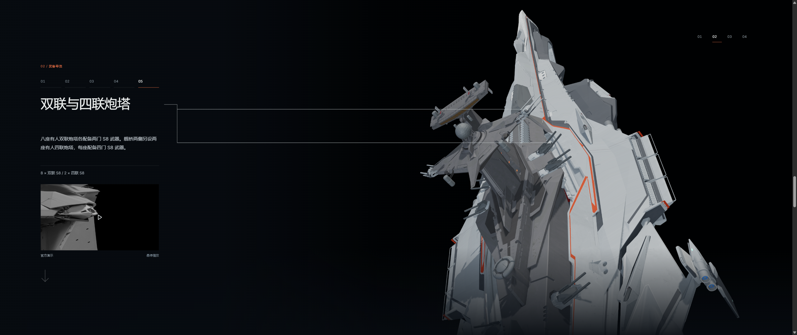
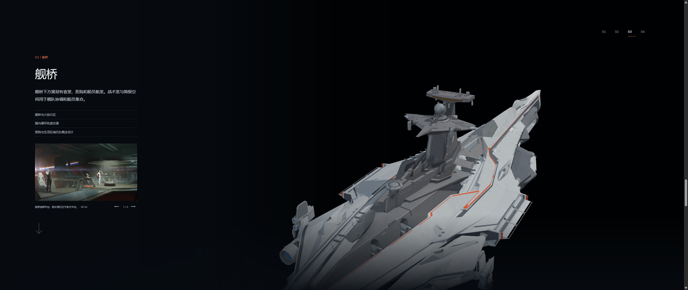
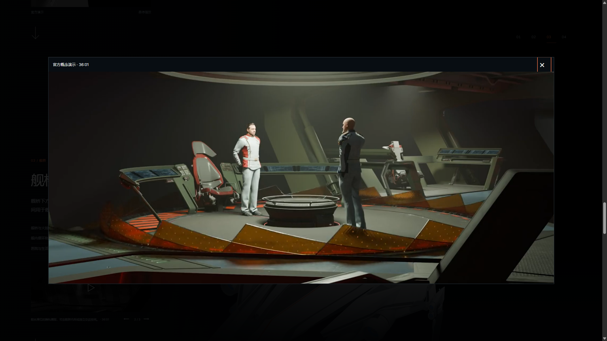
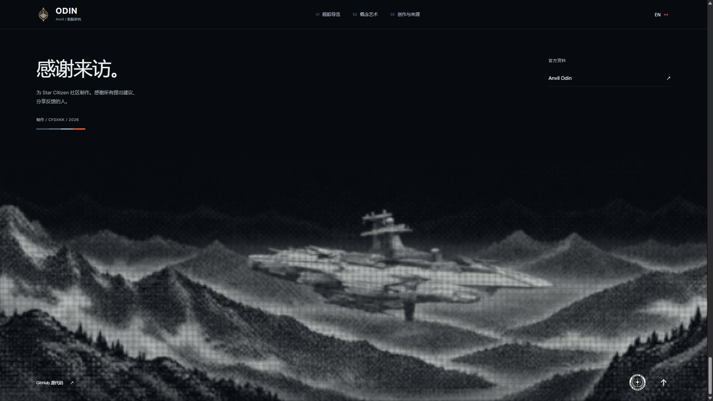
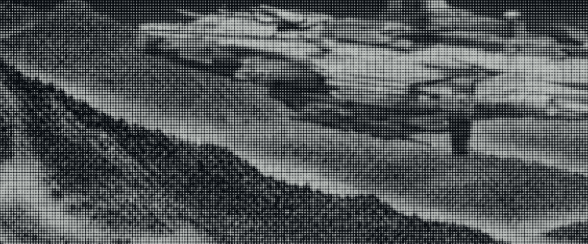

# v0.21.0 — guided continuity and a quieter footer

Candidate: `v0.21.0-rc.1`, branch `codex/odin-guided-continuity-v0.21.0`.

The first weapon leader draws once on entry to chapter 2 at the bow station. It begins during the last 0.15 seconds of the camera handoff, without waiting for the independent weapon mechanism transition. Other weapon leaders appear at full length and follow their anchors. Scrolling within the bow station or returning to it from another weapon does not replay the entrance stroke.

Both routes cross the dorsal spine and finish at the opposite rear quarter. The twin/quad station, bridge and hangar retain that side. Their normalized camera distances are 5.1, 6.2 and 7.3 with one shared aspect-ratio compensation and a constant 33-degree field of view. Position interpolation preserves radius while targets move, avoiding an intermediate push-in. The bow weapon framing still includes its radiator.

The bridge gallery now contains the command platform, a locally hosted captain privacy-divider clip, and the briefing room. The former third schematic is removed. The 4.10-second clip is one complete forward-moving cycle from the official SCL at 36:01, without reversed animation or a crossfade. Its poster comes from its first decoded frame. The preview pauses in grayscale, plays on hover or keyboard focus, and can be enlarged. It stops when the page is hidden, the gallery changes or its chapter is left.

The website's official external navigation is consolidated to one Odin link in the footer. GitHub remains alongside the unlinked community mark. Per-media source URLs remain in the data and provenance records but are no longer scattered across the interface. The founder-badge destination is removed.

The footer keeps the existing composition but removes the etched texture into broad tones before applying one regular 3.2 CSS-pixel screen across ship and mountains. The screen is rendered at native device resolution, with faint upper ridges and a shared tonal treatment. It draws once when visible and only redraws for resizing or resolution changes. [The original Figma investigation](footer-source-study.md) distinguishes the observed pre-screened raster from the unknown upstream screening method. [The comparison page](../../../public/review/footer-screen-v0.21.0.html) retains the selected treatment, a rejected model-derived valley and the previous image.

## Validation

- `npm test`: 138 passed; `npm run verify:asset`: both GLBs valid with zero animation clips; `npm run generate`: passed.
- [Camera continuity](camera-continuity.json): 1,001 samples per transition, both sides, 16:9 / 21:9 / 32:9; radius and projected landmark depth increase throughout.
- [Scene browser checks](scene-qa-summary.json): both actual homepage entry sides, entrance-only line animation, immediate later leaders, opposite rear-side continuity, persistent pause and selected weapon-family deployment.
- [Captain clip provenance and seam measurements](captain-clip-source.json).
- [Gallery browser checks](captain-gallery-browser.json): hover, focus, enlarge, looping, pause lifecycle and removed external links.
- [Responsive browser checks](responsive-qa.json): 1920×1080, 3440×1440, 1366×768 and 390×844; no horizontal overflow, visible gallery controls and footer text/links. The only two external anchors are official Odin and GitHub, both in the footer. GitHub has a transparent background.
- The final print was inspected at native size on an ultrawide viewport. Its render count remained at one during idle; measured initial render time was 21–194 ms across the checked viewports at DPR 1.

No Blender source, GLB, material, joint or mechanical articulation path changed in this revision.

## Captures

