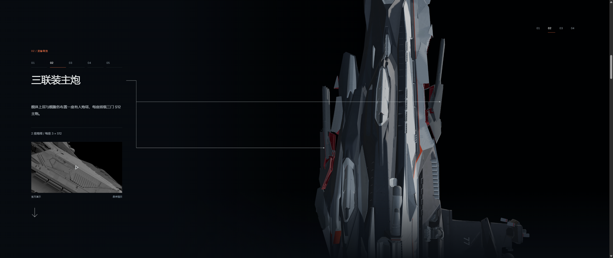
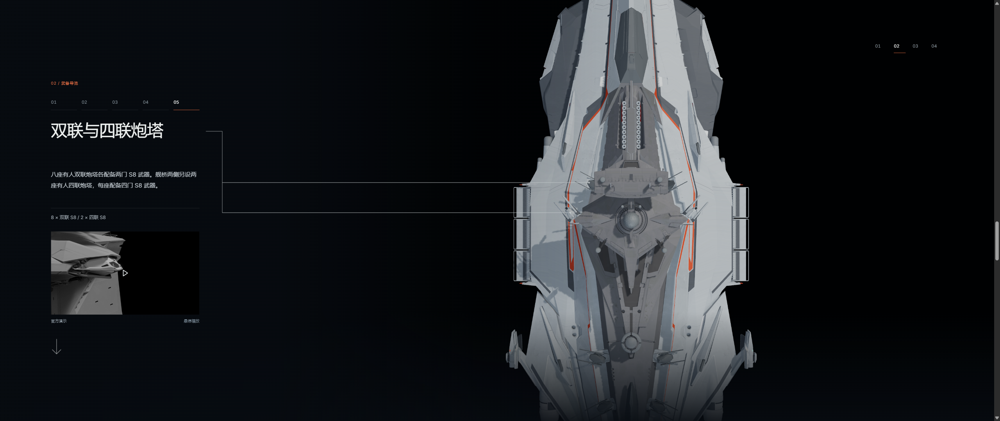
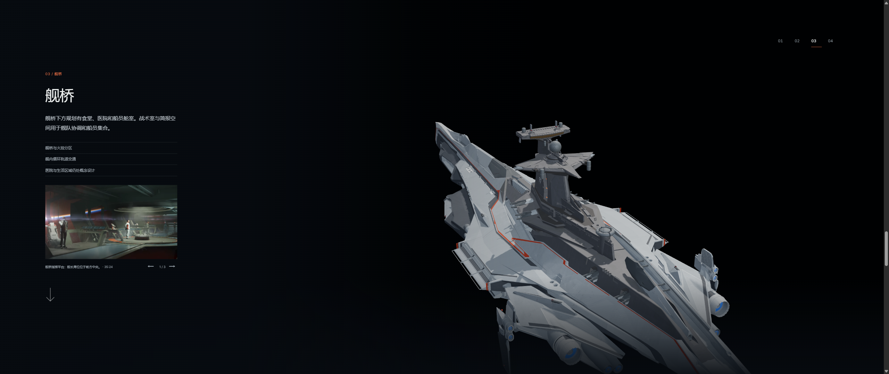
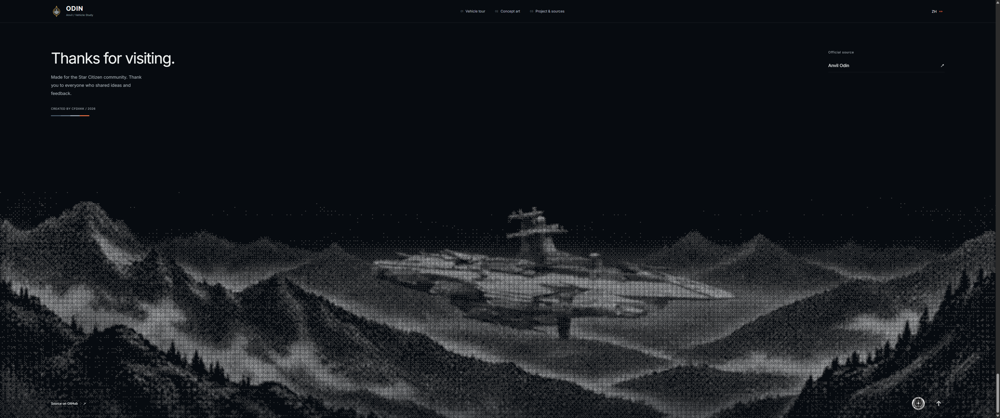
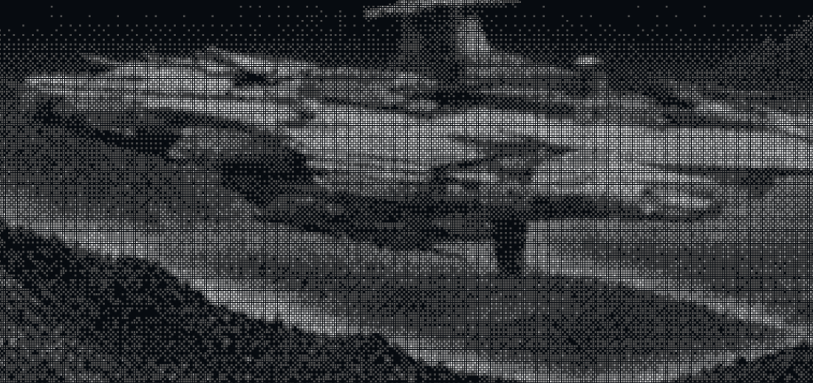

# v0.22.0 — steady weapon inspection and a woven footer

Candidate: `v0.22.0-rc.1`, branch `codex/odin-stable-inspection-v0.22.0`.

The weapon camera holds its entry flank until the ventral triple battery has passed the screen's vertical midpoint. The turn begins at weapon-scroll progress 0.37 and reaches the centered dorsal view at 0.50. It never crosses to the opposite flank. Torpedoes, single batteries and combined twin/quad batteries share exactly the same viewing direction; their differences are translation and a gradual pullback.

Normalized camera distances are 4.5, 5.3, 6.0, 6.3, 6.6, 7.2 and 8.0 from the bow weapon through the aft hull. The turn includes a compensating pullback so the near dorsal surface does not swell as it rotates into view. A shared framing scale and 33-degree lens continue through the bridge and hangars, retaining the established rear-quarter routes and low view of the hangar doors.

Callouts use the actual camera's world-X side. Port selects `SideBattery_2_Port`, `Defense_01_Elevation` and `PDC_Port_Gimbal`; starboard selects their corresponding mounts. At the centered dorsal view they retain the approach side, with a small deadzone to avoid flicker. Main batteries still have separate dorsal and ventral leaders. Only initial entry at the bow animates the leader stroke; later stations continue to display their lines immediately.

The footer replaces variable-radius circles with fixed square marks, four gray ink levels and an ordered 4×4 pattern. Its 3.2-pixel pitch produces a 12.8-pixel repeating pattern, with the same treatment applied to the ship and landscape. Distant scenery fades by ink intensity, never by shrinking marks. [Screen construction and Figma limitations](footer-screen.md) distinguish this interpretation from the original raster's unknown authoring method.

## Validation

- `npm test`: 147 passed.
- `npm run verify:asset`: both shipped GLBs valid, each with 214 meshes, 20 materials, 12 textures and zero animation clips.
- `npm run generate`: passed.
- [Dense camera sampling](camera-continuity.json): both entry sides at four desktop ratios, 10,001 samples per route. Continuous increasing radius, receding fixed turret surfaces, no late orientation changes, and ventral-turret center crossing before rotation.
- [Actual browser scene checks](scene-qa-summary.json): both homepage headings, all five weapon stations, correct side-specific anchors, unchanged first-entry leader timing, persistent explicit pause, selective main/single/defense/quad deployment and bridge/aft pullback.
- [Responsive browser checks](responsive-qa.json): common desktop, ultrawide, compact laptop and phone viewports; footer and gallery remain usable.
- Footer screening tests verify 4×4 periodicity, monotonic tone and checkerboard arrangements. Actual GLB anchor tests cover both model variants and stowed, half-deployed and deployed states.

No geometry, original Blender source, joint transforms or articulation paths changed.

## Captures

